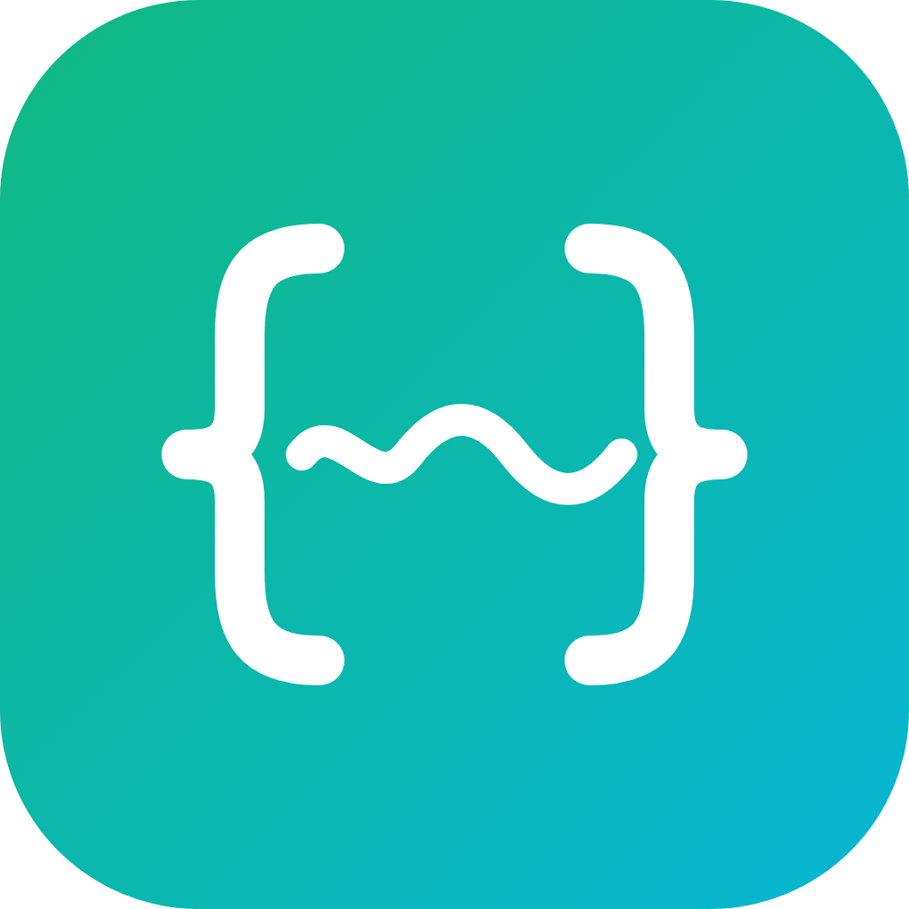

<p align="center">
  
</p>

<h1 align="center">CraftWork</h1>

<p align="center">本地优先、可审计的桌面 Agent</p>

<p align="center">
  Rust · Tauri 2 · 数据不出本机
</p>

---

## 这是什么

CraftWork 是一个完全本地运行的桌面 Agent。它在你的工作区里读文件、改代码、跑命令、看差异，也能读取文档、整理会议纪要、生成邮件草稿。

三条产品原则：

- **本地内核**：Agent、工具、策略、存储、终端、密钥全部由本机主进程执行。
- **本地优先**：会话、密钥、文件与日志保存在本机，不收集遥测。
- **可审计、可撤销**：写文件、执行命令、修改文档都先经过审批，并留下审计记录与备份。

## 核心特性

### 工作区会话与临时会话

- 工作区会话：绑定你添加的项目目录，文件、命令与 Git 都工作在该目录内。
- 临时会话：无需先选择工作区，开箱即聊；会话能力完整，产生的文件保存在应用内置的临时目录（`~/.craftwork/workspace/default`），目录被删除后重启自动重建。
- 会话列表按归属分组：临时会话置顶，其余按工作区分组。

### Code 模式

- 读文件、写文件、精确替换、`apply_patch` 补丁预演与逐块应用、Glob / Grep、Shell。
- Git 工具：状态、差异、提交记录与提交（默认不推送）。
- 面板终端：xterm.js 渲染、真实 PTY（node-pty，独立进程组管理）。

### Work 模式

- Word / Excel 文本级读取与修改，PDF 文本提取；扫描件提示不支持 OCR。
- 文档写入前审批与备份，修改 Word 文本或 Excel 单元格时保留原有结构。

### 对话与工具

- 流式文本、推理折叠、工具卡片、任务清单、错误卡片与运行中引导。
- 停止生成、重新生成。
- 多提供商：OpenAI、Anthropic 与 OpenAI 兼容服务；应用不内置任何提供商，从模型目录导入或手动创建。
- 模型目录：models.dev 快照随应用离线可用；提供商 logo 在构建期下载清洗后内嵌为本地资产，多数提供商导入即预填端点，导入时自动带出上下文、最大输出、能力与价格。
- 模型管理：设置页「模型与提供商」为主从两栏布局（左侧供应商列表 + 右侧详情卡）；支持供应商与模型两级启停、模型增删改、从服务端点拉取模型清单（按 ID 去重合并）；聊天模型选择器只列启用的提供商与模型，调用停用项会得到可读提示。
- 错误分类（限流、认证、超时、上下文溢出等）、有限重试与失败转移（自动跳过停用项）；用量面板按目录价格估算费用。
- 快捷键：⌘K 命令面板、⌘N 新建会话、⌘B 侧栏开合、⌘D 数据面板、⌘, 设置。

### 审批与安全

| 风险 | 含义 | 默认策略 |
| --- | --- | --- |
| R0 | 只读 | 自动允许，记录审计 |
| R1 | 写工作区 | 每次询问，可本会话 / 本工作区授权 |
| R2 | 执行 | 每次询问 |
| R3 | 网络或越界 | 每次询问，不提供永久允许 |
| R4 | 破坏性 | 阻止 |

- 三档审批：分级 / 严格 / 只读（另有「自由」档需显式确认）。
- 受限工作区直接拒绝网络访问，不提供任何永久授权。
- 写文件前自动备份，可在数据面板恢复。
- 审批决定、工具调用、文件写入全部落本地审计。

### 本地优先

- SQLite（WAL，`node:sqlite`）保存会话、事件、审批、审计、用量与设置；事件表按会话 `seq` 单调递增，是消息与部件的唯一事实源。
- 密钥保存在 `~/.craftwork/keys.json`（0600），只存在于主进程。
- 渲染进程开启 `contextIsolation`、关闭 `nodeIntegration`，不加载任何远程页面；外链经确认后交给系统浏览器。
- 工具子进程运行在清洗后的环境中（白名单变量 + 敏感词剔除），独立进程组、超时杀树、输出截断。
- 不收集遥测，不上传代码或文档。

## 技术架构

```text
┌──────────────────────────────────────────────────────────┐
│ 渲染层  src/renderer（React 19 + zustand + Tailwind v4）  │
│ 侧栏（会话分组） · 对话流（卡片体系） · 右侧面板 · 浮层    │
└───────────────┬──────────────────────────────────────────┘
                │ contextBridge（集中通道表，preload 只做桥）
┌───────────────▼──────────────────────────────────────────┐
│ 主进程  src/main（领域内核，普通 TypeScript 模块）        │
│ services 编排 · agent Run 循环 · tools 工具 · policy 策略 │
│ model 提供商接入 · store SQLite · secret 密钥 · doc 文档  │
└───────────────┬──────────────────────────────────────────┘
                │
   SQLite（node:sqlite） / 文件系统 / PTY（node-pty） / keys.json
```

| 层 | 目录 | 职责 |
| --- | --- | --- |
| 入口 | `src/main/index.ts` | 单实例、数据目录、服务装配、窗口、通知 |
| 桥 | `src/preload` | contextBridge 暴露集中通道表 |
| 界面 | `src/renderer` | React 界面；事件驱动状态壳（zustand） |
| 领域 | `src/main/services`、`agent`、`tools`、`policy`、`model` | 参数校验与编排、Run 循环、工具、风险分级、模型接入 |
| 基础设施 | `src/main/store`、`core`、`doc` | SQLite、事件总线、原子写/环境清洗/子进程、密钥、行级 diff、文档处理 |
| 共享 | `src/shared` | 事件契约、类型、IPC 通道表 |

### 关键设计

- **事件表是唯一事实源**：消息与部件从事件行重建（快照），不另存副本；用户消息先落事件表再启动运行。
- **三道防线互相独立**：工具自身参数校验；策略引擎决定是否审批；路径解析拒绝越界（词法 + 符号链接真实路径双重校验）。
- **运行环境是值不是全局态**：运行开始时从会话绑定的工作区一次性解析，沿调用图下发。
- **审批必须显式决定**：请求 → 卡片 → 用户决定 → 执行/跳过；决定一经写入不可更改，拒绝一律只授权一次。
- **深浅两套主题**：语义色 token 经 Tailwind v4 `@theme inline` 映射，跟随系统或手动切换即时生效。

更完整的技术细节见 [架构规格](docs/specs/architecture.md)，设计决策的背景与取舍见 [docs/adr/](docs/adr/)。

## 快速开始

### 环境要求

- Node.js ≥ 24（`node:sqlite` 为稳定内置模块）
- pnpm（包管理）
- macOS（当前实测平台；Windows / Linux 待实机验证）

### 运行

```bash
pnpm install
pnpm dev
```

### 构建

```bash
pnpm dist        # target/release/bundle/dmg/*.dmg（Tauri bundler）
pnpm dist:dir    # 只产出 .app 目录（debug 构建）
```

### 模型目录

模型目录来自 [models.dev](https://models.dev)，在构建期同步并内嵌进源码，运行时不需要联网。更新目录后提交生成文件：

```bash
node scripts/modelsync.mjs          # 拉取上游并重新生成快照与内嵌模块
node scripts/modelsync.mjs --check  # 只检查是否与上游一致
```

首次启动没有任何提供商；在「设置 → 模型与提供商」里从目录导入（端点自动预填、模型参数自动带出，详情卡里可增删改模型或从服务端点拉取最新清单），或手动配置 Ollama、公司网关等端点。配置密钥后即可对话。使用 `CRAFTWORK_HOME=/tmp/craftwork-dev` 可以隔离数据目录。

> 全部开发命令、目录约定、实现约束与常见坑见 [AGENTS.md](AGENTS.md)。

## 参与贡献

欢迎提 issue 与 Pull Request。spec 与 issue 以本地 markdown 存放在仓库内（`docs/<feature>/`），不使用 GitHub Issues，约定见 [docs/agents/issue-tracker.md](docs/agents/issue-tracker.md)。完整的环境准备、代码约定、检查命令与提交规范见 [CONTRIBUTING.md](CONTRIBUTING.md)。

### 开始之前

1. 阅读 [AGENTS.md](AGENTS.md)：里面有命令、代码结构、审批 / 安全 / 界面约定，以及 Agent skills 协作约定（issue tracker、triage 标签、领域文档）。
2. 阅读 [架构规格](docs/specs/architecture.md)；涉及决策取舍时查 [docs/adr/](docs/adr/)。

### 流程

1. Fork 仓库并从 `main` 建分支。
2. 修改代码，补对应测试（核心逻辑 cargo test，覆盖策略、diff、存储、Agent、工具与模型层）。
3. 运行检查：

```bash
pnpm typecheck     # 渲染层类型检查
pnpm test:rust     # cargo test --workspace（领域内核）
pnpm lint:rust     # cargo clippy
pnpm dist:dir      # 打包冒烟（.app 可启动）
```

4. 涉及界面时，在 1440×900 窗口尺寸确认三栏布局与深浅主题。
5. 提交 PR，描述变更、验证方式与影响的文档。
6. 贡献使用 DCO：`git commit -s`。

### 适合上手的方向

- 沙箱与自动更新。
- Word / Excel / PDF 的结构化解析与写入（当前为文本级）。
- MCP（stdio 客户端接入内置工具注册表）。
- 真实密钥验收：配置 OpenAI、Anthropic 或任意 OpenAI 兼容网关的密钥后跑通工具调用闭环。
- 跨平台：Windows（ConPTY 终端）与 Linux 打包的实机验证。

## 文档

- [产品规格](docs/specs/product.md)：定位、范围、非功能指标与验收
- [功能规格](docs/specs/features.md)：功能编号、优先级与验收要点
- [架构规格](docs/specs/architecture.md)：分层、事件流、Agent 内核、策略与存储
- [系统提示词契约](docs/specs/prompt-contract.md)：提示词分节与缓存分层
- [决策记录（ADR）](docs/adr/)：架构与选型决策的背景与取舍
- [术语表](GLOSSARY.md)：仓库领域词汇基准
- [Agent skills 约定](docs/agents/)：issue tracker（本地 markdown）、triage 标签与领域文档消费规则
- [贡献指南](CONTRIBUTING.md)
- [开发与协作约定](AGENTS.md)

## 许可证

Apache-2.0，见 [LICENSE](LICENSE)；贡献流程使用 DCO（`git commit -s`）。

内置的模型目录数据来自 [models.dev](https://models.dev)，使用 MIT 许可；完整声明见 [THIRD_PARTY_NOTICES.md](THIRD_PARTY_NOTICES.md)。
