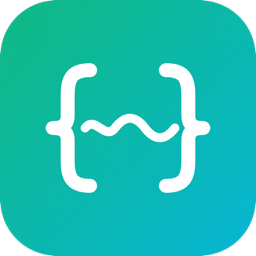
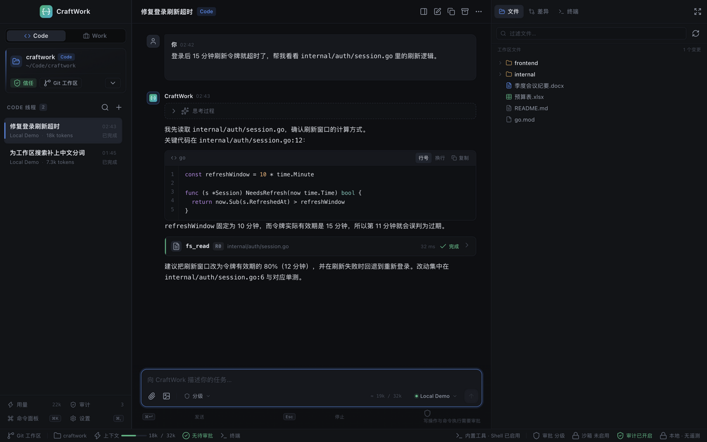

<p align="center">
  
</p>

<h1 align="center">CraftWork</h1>

<p align="center">本地优先、可审计的桌面 Agent</p>

<p align="center">
  Go 内核 · Wails3 桌面外壳 · React 界面 · 数据不出本机
</p>



---

## 这是什么

CraftWork 是一个完全本地运行的桌面 Agent。它在你的工作区里读文件、改代码、跑命令、看差异，也能读取文档、整理会议纪要、生成邮件草稿。

三条产品原则：

- **Go 内核**：Agent、工具、策略、存储、终端、密钥全部由 Go 执行。
- **本地优先**：会话、密钥、文件与日志保存在本机，不收集遥测。
- **可审计、可撤销**：写文件、执行命令、修改文档都先经过审批，并留下审计记录与备份。

## 核心特性

### Code 模式

- 工作区文件树、Git 状态、CodeMirror 代码编辑与搜索。
- 读文件、写文件、精确替换、`apply_patch` 补丁预演与逐块应用、Glob / Grep、Shell。
- Git 工具：状态、差异、提交记录与提交（默认不推送）。
- 统一 / 并排差异视图，支持在审批卡片中查看完整差异或补丁预览。
- 多标签终端，Go 侧真实 PTY + xterm.js 渲染，支持输出搜索与滚动历史。

### Work 模式

- Word / Excel 文本级读取与修改，PDF 文本提取；扫描件提示不支持 OCR。
- 文档写入前审批与备份，修改 Word 文本或 Excel 单元格时保留原有结构。
- 会议纪要、表格、邮件草稿等办公场景的对话流。
- 邮件与日历可通过本地 MCP 服务器（stdio）接入；草稿只在应用内生成，不自动发送。

### 对话与工具

- 流式文本、推理折叠、工具卡片、任务清单、错误卡片。
- 停止生成、重新生成、线程内切换模型。
- 附件、拖放、`path:line` 引用、Markdown 表格与代码块高亮。
- 多提供商：本地演示、OpenAI 与 OpenAI 兼容服务、Anthropic Messages、Google Gemini。
- 错误分类（限流、认证、超时、上下文溢出等）、有限重试与失败转移。

### 审批与安全

| 风险 | 含义 | 默认策略 |
| --- | --- | --- |
| R0 | 只读 | 自动允许，记录审计 |
| R1 | 写工作区 | 每次询问，可本会话 / 本工作区授权 |
| R2 | 执行 | 每次询问 |
| R3 | 网络或越界 | 每次询问，不提供永久允许 |
| R4 | 破坏性 | 阻止 |

- 三档审批：分级 / 严格 / 只读。
- 受限工作区直接拒绝网络访问，不提供任何永久授权。
- 写文件前自动备份，可在备份面板恢复。
- 审批决定、工具调用、文件写入全部落本地审计。

### 本地优先

- SQLite（WAL）保存线程、事件、审批、审计、用量与设置。
- 密钥保存在 `~/.craftwork/keys.json`（0600），只存在于 Go 进程。
- 生产构建带严格 CSP；界面只加载本地内嵌资源，外链交给系统浏览器。
- 不收集遥测，不上传代码或文档。

## 技术架构

```text
┌──────────────────────────────────────────────────────────┐
│ 前端  React 19 + TypeScript + Vite                       │
│ 三栏界面 / 聊天 / 面板 / 浮层 / 主题                      │
│ assistant-ui（headless）· CodeMirror 6 · xterm.js        │
└───────────────┬──────────────────────────────────────────┘
                │ bindings（命令）      cw:events（批量事件）
┌───────────────▼──────────────────────────────────────────┐
│ Wails3 宿主                                              │
│ 窗口 / 单实例 / 系统 WebView / 资源嵌入 / CSP             │
└───────────────┬──────────────────────────────────────────┘
                │
┌───────────────▼──────────────────────────────────────────┐
│ Go 应用服务                                              │
│ service → agent · tools · policy · model                 │
│         → store · secret · editor · terminal             │
└───────────────┬──────────────────────────────────────────┘
                │
        SQLite / 文件系统 / PTY / keys.json
```

| 层 | 目录 | 职责 |
| --- | --- | --- |
| 入口 | `main.go` | 嵌入前端产物，启动应用 |
| 宿主 | `internal/app` | 窗口、单实例、CSP、服务装配 |
| 绑定 | `internal/service` | 9 个服务：App / Settings / Thread / Chat / Workspace / Provider / Audit / Terminal / Document |
| 领域 | `internal/agent`、`tools`、`policy`、`model` | Run 循环、工具、风险分级、模型接入 |
| 基础设施 | `internal/store`、`secret`、`editor`、`events` | SQLite、密钥、差异、事件总线 |
| 前端 | `frontend/src` | `features/` 按界面区域拆分，`stores/` 管理状态，`lib/` 封装桥接与 Mock |

### 关键设计

- **Wails3 使用系统 WebView**：不打包 Chromium，应用体积小、内存可控。
- **assistant-ui primitives**：消息流与输入区复用成熟原语，视觉仍由原型 CSS token 控制。
- **事件批量推送**：文本增量在 Go 侧按 33ms 合并，避免逐 token 过 IPC。
- **审批跨 IPC**：Go 推送 `approval.requested`，前端调用 `DecideApproval` 回传；授权范围由服务端校验。
- **原型即视觉基线**：`docs/prototype/` 的 class 名、CSS token 与 DOM 结构被前端直接复用。
- **安全边界在 Go**：路径校验、命令分级、密钥读取、外链白名单都不依赖前端。

更完整的技术细节见 [技术设计方案](docs/技术设计方案.md)。

## 快速开始

### 环境要求

- Go 1.26+（以 `go.mod` 的 `go` 指令为准）
- Node.js 24+（Vite 8 要求；npm 随 Node.js 提供）
- Wails3 CLI v3.0.0

安装或升级 Wails3 CLI：

```bash
go install github.com/wailsapp/wails/v3/cmd/wails3@v3.0.0
wails3 doctor
```

确保 `GOBIN` 或 `$(go env GOPATH)/bin` 在 PATH 中。`wails3 doctor` 会检查系统 WebView、编译工具与前端环境；按提示补齐依赖即可。macOS 需要 Xcode Command Line Tools，Windows 需要 WebView2 Runtime，Linux 需要 WebKitGTK。

### 运行

```bash
cd frontend && npm install && cd ..

wails3 generate bindings -clean=true -ts -i
wails3 dev
```

### 构建

```bash
wails3 build      # bin/craftwork
wails3 package    # bin/craftwork.app（macOS）
```

### 浏览器预览

不需要启动 Wails，使用内存 Mock 后端：

```bash
cd frontend && npm run dev
# http://127.0.0.1:9245/
```

### 演示数据

```bash
CRAFTWORK_DEMO=1 wails3 dev
```

首次启动创建 `~/.craftwork`；使用 `CRAFTWORK_HOME=/tmp/craftwork-dev` 可以隔离数据目录。

> 全部开发命令、目录约定、实现约束与常见坑见 [AGENTS.md](AGENTS.md)。

## 参与贡献

欢迎提交 Issue 与 Pull Request。完整的环境准备、代码约定、检查命令与提交规范见 [CONTRIBUTING.md](CONTRIBUTING.md)。

### 开始之前

1. 阅读 [AGENTS.md](AGENTS.md)：里面有命令、代码结构、IPC / 审批 / 安全 / 前端约束。
2. 阅读 [技术设计方案](docs/技术设计方案.md) 与 [界面设计方案](docs/界面设计方案.md)。
3. UI 相关改动先对照 [原型](docs/prototype/index.html)，保持视觉一致。

### 流程

1. Fork 仓库并从 `main` 建分支。
2. 修改代码，补对应测试。
3. 运行检查：

```bash
wails3 task test
wails3 task check
wails3 build
```

4. 涉及 UI 时，在 1440×900 与 1100×800 两个视口对照原型，确认三栏、窄窗口折叠与深浅主题。
5. 提交 PR，描述变更、验证方式与影响的文档。
6. 贡献使用 DCO：`git commit -s`。

CI 会运行 Go 测试与静态检查、前端类型检查与构建、绑定漂移检查以及依赖审计；PR 合并前需要全部通过。

### 适合上手的方向

- M3：Word / Excel / PDF 的结构化解析与写入。
- M4：MCP 客户端、沙箱、自动更新、签名与公证。
- 真实密钥验收：配置 OpenAI / Anthropic / Gemini 密钥后跑通工具调用闭环。
- 跨平台：Windows 通知、Linux 打包与 CI 兼容性。

## 路线图

| 阶段 | 状态 | 目标 |
| --- | --- | --- |
| M0 骨架 | 已完成 | 三栏界面、流式对话、工具与审批、编辑器、差异、终端、设置、审计 |
| M1 对话 | 已完成 | 多提供商原生协议、上下文压缩、附件内容、通知、前端测试 |
| M2 Code 闭环 | 已完成 | 命令前缀授权、补丁预演、Git 工具、终端搜索 |
| M3 Work 模式 | 已完成（文本级） | Word / Excel / PDF 文本级读写、文档差异与备份 |
| M4 安全与发布 | 部分完成 | MCP stdio 已接入；沙箱、自动更新、签名、公证、安装包未完成 |

## 文档

- [产品需求文档](docs/产品需求文档.md)
- [技术设计方案](docs/技术设计方案.md)
- [界面设计方案](docs/界面设计方案.md)
- [高保真原型说明](docs/prototype/README.md)
- [贡献指南](CONTRIBUTING.md)
- [开发与协作约定](AGENTS.md)

## 许可证

Apache-2.0，见 [LICENSE](LICENSE)；贡献流程使用 DCO（`git commit -s`）。
