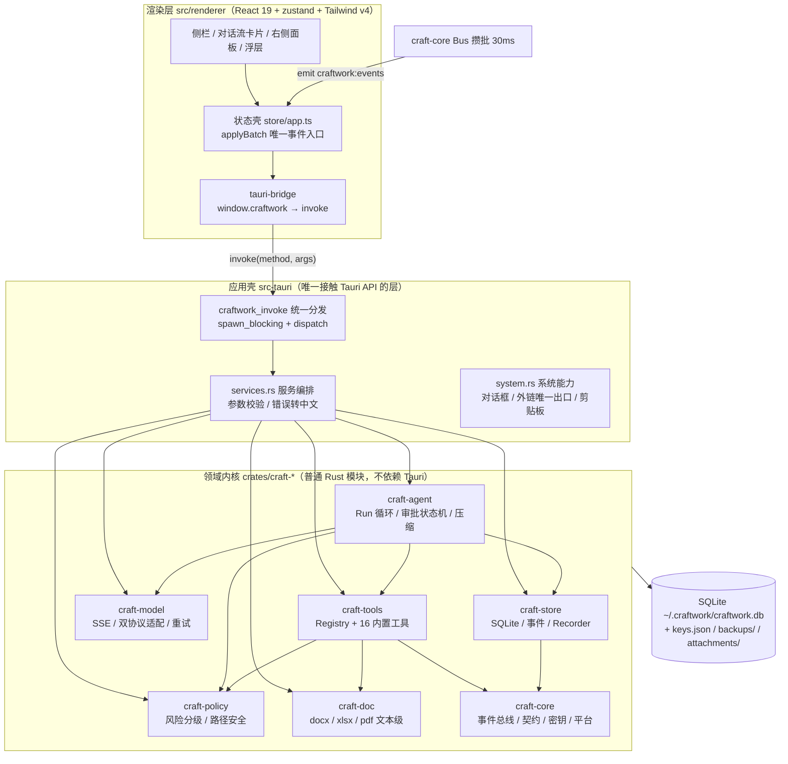
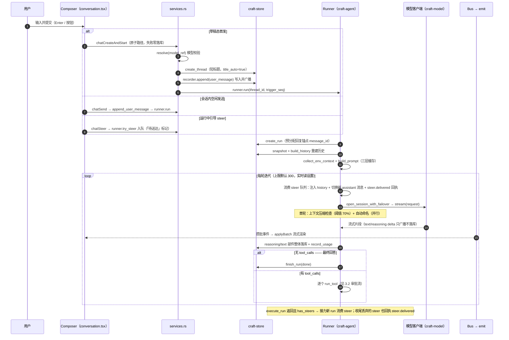
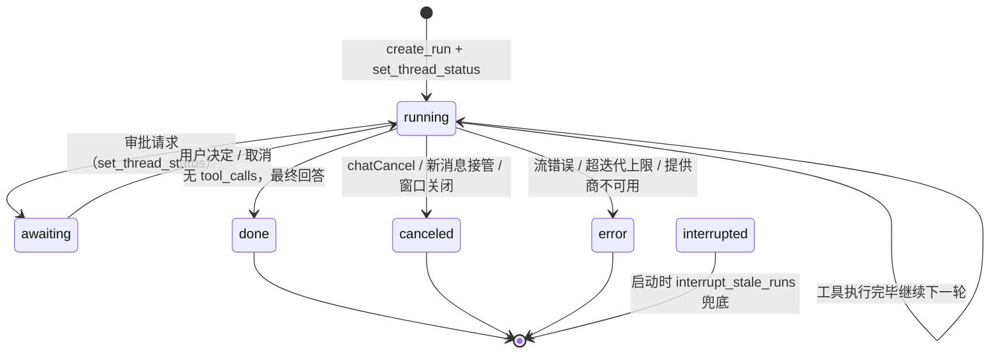
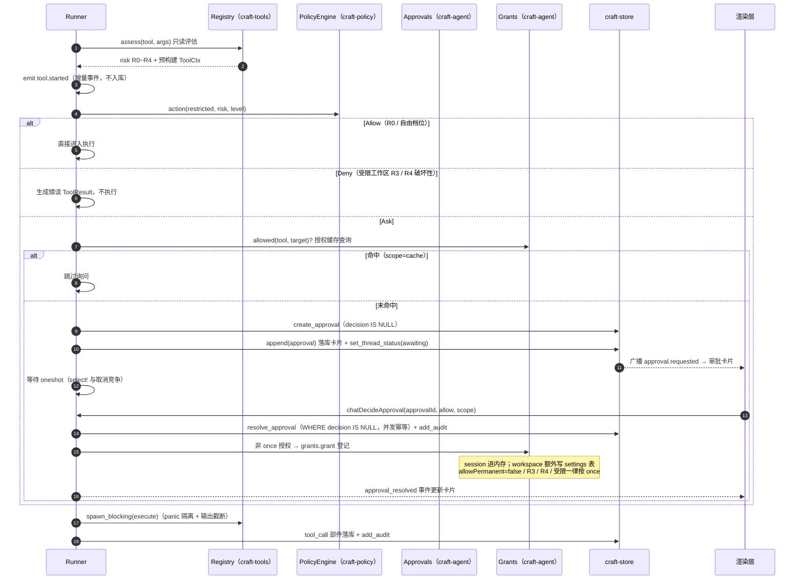
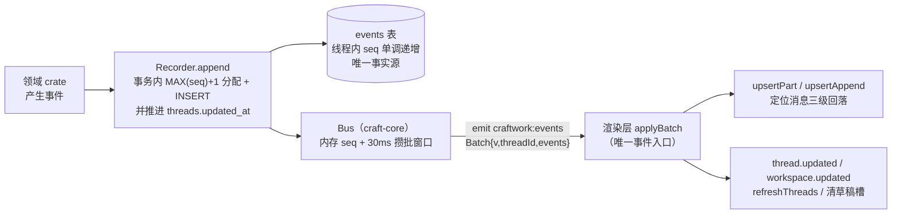
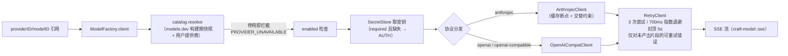

# CraftWork 架构文档

本文是架构事实源：分层结构、主业务流程、事件管道、安全模型与历史决策摘要。术语以仓库根 [GLOSSARY.md](../GLOSSARY.md) 为准；开发约定见 [AGENTS.md](../AGENTS.md)，行为规格与本地票据约定见 [docs/agents/issue-tracker.md](agents/issue-tracker.md)。

## 1. 定位与原则

CraftWork 是完全本地运行的桌面 Agent：在本机读文件、改代码、跑命令、处理文档。三条产品原则约束所有架构取舍：

- **本地内核**：Agent 循环、工具、策略、存储、密钥全部由本机 Rust 进程执行。
- **本地优先**：会话、密钥、文件与日志保存在本机，不收集遥测；应用不内置任何提供商。
- **可审计、可撤销**：写文件、执行命令、修改文档先经审批，留下审计记录与写前备份。

## 2. 分层架构

| 层 | 目录 | 职责 | 关键约束 |
| --- | --- | --- | --- |
| 界面 | `src/renderer` | React 界面；事件驱动状态壳 | 不持有 Node 能力；颜色走语义 token；系统操作只经通道表 |
| 共享契约 | `src/shared` | `channels.ts` 通道表、`events.ts` 事件契约、`types.ts`、`ids.ts` | 与 `craft-core::contract` 经契约金样与 dispatch 对拍测试防漂移 |
| 应用壳 | `src-tauri` | 窗口装配、`craftwork_invoke` 分发、服务编排、系统能力 | 唯一允许 import Tauri 的层 |
| Agent | `crates/craft-agent` | Run 循环、审批状态机、授权缓存、历史重建、上下文压缩、自动命名、提示词组装、环境上下文 | 运行环境是值（RunEnv）不是全局态 |
| 工具 | `crates/craft-tools` | `Tool` trait（spec + execute）、Registry 统一横切（路径解析 / 输出截断 / 写前备份 / panic 隔离） | 同步执行，调用方负责放入阻塞线程 |
| 策略 | `crates/craft-policy` | 风险分级 R0~R4、审批档位、命令分类、路径安全解析、敏感附件名 | 档位只是引擎输入，不改变风险分级 |
| 模型 | `crates/craft-model` | 统一客户端：目录快照、SSE、OpenAI/Anthropic 适配、重试、错误归一化 | 错误必须映射为错误码，不抛原始 HTTP 错误 |
| 存储 | `crates/craft-store` | SQLite 打开/迁移、threads/workspaces/events/runs/approvals、审计/用量/设置/备份、Recorder | seq 分配与插入同事务；事件表是唯一事实源 |
| 基础 | `crates/craft-core` | 事件总线（30ms 攒批）、契约类型、ID、原子写/哈希/环境清洗/子进程、密钥、行级 diff | 被全部领域 crate 依赖 |
| 文档 | `crates/craft-doc` | docx / xlsx / pdf 文本级读写（低层 zip + XML） | 文本级：只改内容不重建排版 |

数据目录 `~/.craftwork`（`CRAFTWORK_HOME` 可隔离）：`craftwork.db`、`keys.json`（0600）、`backups/`、`attachments/`、`workspace/default`（内置临时会话目录）。

## 3. 主业务流程

### 3.1 发送一条消息（首发原子路径 + Run 循环）

要点：

- **首发原子路径**（`services.rs::chat_create_and_start`）：模型校验前置，任何一步失败零落库；侧栏与数据库因此天然不存在空会话。
- **用户消息先落事件表再启动 Run**；首发后 Run 启动失败不回滚（会话保留可重试）。
- **同会话同时只允许一个 run**：`Runner.run` 对旧 token 先 cancel 再登记新 token（新消息接管）。
- **失败转移**只在「建流前」发生：候选链 = 主模型 + `fallbackModel` 设置解析出的备选；流一旦建立，错误不再转移（交由 RetryClient 的同模型重试处理）。
- 四种终态：`done`（complete）/ `canceled`（取消）/ `error`（fail，先落 error 部件）/ `interrupted`（启动时 `interrupt_stale_runs` 兜底收尾上次未完成的 run）。

### 3.2 Run 状态机

### 3.3 审批与授权（三道防线）

三道防线互相独立：工具自身参数校验；策略引擎决定是否审批；`craft-policy::resolve` 路径解析拒绝越界（词法校验 + 符号链接真实路径双重校验，不信任渲染层传来的路径）。审批必须显式决定，不允许后端静默放行；决定一经写入不可更改；取消、窗口关闭、应用退出统一按拒绝或取消落审计。

### 3.4 事件管道（写库 → 攒批 → 广播 → 应用）

- **增量事件**（text.delta / reasoning.delta / tool.started）只广播不落库；落库的是部件整体（reasoning / text / tool_call 完成态）。
- 落库失败降级为纯广播（`append_or_warn`），保证界面不因存储故障卡死。
- 快照与在途事件合并：切换会话拉全量快照（权威序），事件流独有的 streaming 消息追加尾部（`mergeStreamedMessages`）。

### 3.5 停止与取消

- 停止按钮（armed 二次确认 800ms）与运行中双击 Esc 共享 armed 态，都走 `chatCancel` → `Runner.cancel`：从 `cancels` 表取出该会话的 `CancellationToken` 并 cancel；流消费与审批等待处 `tokio::select!` 感知，分别进入 `canceled` 终态与审批取消收尾。
- 窗口关闭 / 应用退出：`on_window_event(CloseRequested)` 与 `RunEvent::ExitRequested` 两处调 `cancel_all_runs`（逐会话 cancel + 审计 decision="canceled"）；异步收尾未完成的由下次启动 `interrupt_stale_runs` 标记 interrupted 兜底。
- 运行中引导 steer：入队暂存（上限 `MAX_STEER_QUEUE`），当前工具批次结束后并入下一次模型请求；run 正常结束后若有未消费 steer，自动接力为新 run。
- **steer 投递回执**（`steer.delivered`）：每条引导在消费（注入 history）或收尾丢弃时落库 + 广播回执，前端据此摘除「待送达」标记（via）——标记生命周期完全由回执驱动，`run.started` 不再全量清除（接力时队列里的引导尚未消费，提前清除会误伤）；快照重建同样按回执摘除 via（无回执的引导重启后仍显示待送达）。消费点同时切换新 assistant 消息（`nextMessageId`）：后续输出与引导气泡之间的时间线时序和视觉位置一致，旧消息就此封口。

### 3.6 快照装载与草稿

- **快照**：切换会话 → `threadSnapshot` → `craft-store::events::snapshot`：按 seq 升序读事件，按 messageId 归组重建消息与部件；审批状态回填以 approvals 表 `decision IS NULL` 为准；runs 表给无事件 run 补占位消息（权威信号 = `trigger_seq + 1`）。
- **草稿槽**：未发首条消息的会话意图，不写事件表、不进会话列表；按「模式 × 工作区」分槽存 localStorage 单键 `craftwork-drafts`（内容跨重启恢复）；项目删除经 `WORKSPACE_UPDATED{removed}` 事件清对应槽。

## 4. 存储模型

SQLite（rusqlite bundled + WAL，单连接 Mutex 串行）是事实源；消息与部件不另存副本，从事件表重建。

| 表 | 职责 |
| --- | --- |
| `events` | 会话事件，`(thread_id, seq)` 单调递增；写入在事务内完成（seq 分配与插入同事务） |
| `threads` | 会话行（标题、状态、title_auto 标记、updated_at 随事件推进） |
| `workspaces` / `workspace_folders` | 工作区与多源文件夹（首个为主要目录）、信任档（trusted / restricted） |
| `runs` | Run 生命周期（status 终态、message_id 回复锚点、trigger_seq） |
| `approvals` | 审批事实（请求载荷 + 决定；`WHERE decision IS NULL` 做并发幂等） |
| `audit_log` | 工具调用与审批决定（自由档位下是事后追责唯一手段） |
| `usage` / `backups` / `settings` | 用量（含费用估算）、写前备份（SHA-256 登记）、设置（含 workspace_grants） |

schema 变更只在 `craft-store/src/db.rs` 的 `MIGRATIONS` 追加版本，已发布版本号语义不得改动；与历史 Node 版数据库双向兼容（golden 样本对拍测试保障）。

## 5. 安全模型

| 机制 | 实现 |
| --- | --- |
| 风险分级 | R0 读 / R1 写工作区 / R2 执行 / R3 网络或越界 / R4 破坏性；参数可提升风险 |
| 审批档位 | graded / free；free 是唯一放行一切的档位，切换需「能力清单 + 风险勾选」确认门；档位切换即时生效。历史档位 strict/readonly 已移除，旧存储值回落 graded |
| 授权范围 | once / session / workspace；`allowPermanent=false`、R3、R4、受限工作区一律不给永久授权 |
| 受限工作区 | R3 直接拒绝、R1/R2 逐次审批、已有授权不生效、不提供永久授权 |
| 路径安全 | `craft-policy::resolve`：词法校验（越界 / 反斜杠 / 双斜杠）→ 符号链接真实路径解析 → 必须落在工作区根内 |
| 命令执行 | `shell_exec`：独立进程组、环境白名单清洗、超时杀进程组（含孙进程）、有界输出缓冲 + 截断；不是交互式终端（已移除，决策 D1） |
| 密钥 | 只存 Rust 进程与 `~/.craftwork/keys.json`（0600，损坏降级启动）；不进日志、数据库、渲染层 |
| 界面隔离 | CSP + capabilities 开启；不加载远程页面；外链唯一出口经 `open_external` 校验（http/https）交系统浏览器；`on_navigation` 拦截就地导航 |
| 数据保护 | 写前备份到 `backups/` 并记 SHA-256；数据面板可恢复；恢复前对当前文件再备份 |

## 6. 模型接入

- 提供商与模型目录来自 `assets/catalog/catalog.json.gz`（models.dev 构建期快照，`include_bytes!` 嵌入）；用户自定义提供商存 settings 的 `model.custom_providers`；应用不内置任何可用提供商。
- 用户提供商可配置自定义请求头（`PersistedProvider.headers`，如网关路由头 `x-opencode-session`）：随每次模型请求/测试连接/拉取模型附加，保存时服务端校验（名称限 RFC 7230 token、值禁换行、`authorization`/`x-api-key` 与密钥字段冲突拒绝、去重、16 条 / 4KB 上限）；渲染层 `lib/provider-headers` 提供同规则的即时反馈，最终以服务端为准。头值支持 `{sessionId}` 占位符——发送时替换为当前会话 ID（`Request.session_id`，Agent 主对话与命名/预测/压缩 sidecar 均填入），每会话独立路由；无会话上下文的请求跳过含占位符的头。
- 错误归一化：HTTP 状态码 → 基础错误码，关键词二次修正（如 400/401 也可能报限流、流内错误无状态码）；界面只见 `auth / rate_limit / timeout / context_overflow` 等错误码。
- 用量口径单一事实源在 `craft-store::usage_stats`（runner 落库与视图投影共用）：上下文占用 = 最近一次主对话请求的**归一化完整提示词（含缓存读+写，`Usage.prompt_tokens`，由各协议适配器填充）+ 输出**，每轮覆盖更新（旧行无归一化值回退 `input + output`）；输出速率分母 = 生成窗口（收流结束 − 首 token，落 `usage.gen_window_ms`），「隐藏思考」（有 reasoning token 但未流式输出，如 OpenAI 系）回退全程时长，窗口无效（取消/失败轮、过短）为 unrated 记 0、绝不当作真实 0 tok/s；网关不给 usage 时不落用量行（全 0 行会污染水位/速度推导），取消/失败轮部分用量（Anthropic `message_start` 已知 input/缓存）照常落库。历史超过模型窗口 70% 触发压缩（每轮检查：最近实测 `prompt_tokens` 优先比阈值，无实测回退字符估算；估算公式 CJK 感知——中文 1 字 ≈ 1 token；会话模型生成摘要，落 `context_summary` 事件，失败不阻断）。
- 系统提示词三层缓存：identity（无缓存标记）/ stable（跨会话一致）/ dynamic（会话内一致），Anthropic 侧映射为前缀缓存断点。

## 7. 架构决策摘要

完整背景见 git 历史中的原 ADR 与迁移计划（已归档）；以下为仍约束当前开发的决策摘要。

| # | 决策 | 要点 |
| --- | --- | --- |
| ADR-0001 | 新建会话延迟落库与草稿槽 | 新建只是渲染层草稿，首发才原子落库；侧栏与数据库天然无空会话；Run 启动失败不回滚（用户消息先落事件表是仓库原则） |
| ADR-0002 | 采用 Tauri 2 重构桌面外壳 | Electron → Tauri 2：主进程领域逻辑 Rust 重写，渲染层原样保留；数据层双向兼容可回滚；连带决策：移除终端、Agent 自研、craft- 前缀 |
| D1 | 移除终端功能 | 不引入 PTY/xterm；`shell_exec` 保留命令执行能力；WKWebView 中文 IME 风险与 node-pty 跨平台打包障碍一并消除；**不要重新引入 PTY 相关代码** |
| D2 | Agent 侧完全自研 | 参考 openai/codex 的设计与工程拆分（非代码复制）；不引入 rig / genai / goose；基础设施 crate（tokio、rusqlite、reqwest 等）仍用成熟第三方库 |
| D3 | crate 命名 craft- 前缀 | 无前缀的 `core` 遮蔽 Rust 内置 crate，`::core::` 绝对路径连带 derive 宏失效（实测 E0432），硬冲突无规避价值 |
| D4 | 右侧面板保留「文件 / 文档」两个标签 | 终端标签移除后结构不动，默认标签为「文件」 |
| D5 | MCP（stdio 客户端）留桩 | 设置页可存服务器配置，连接能力不实现；rmcp 接入单独立项 |
| D6 | 先出未签名包；updater 链路未接线 | tauri-plugin-updater 未引入、无签名公钥，仅设置字段留存；凭据到位后另立项接线 |
| D7 | 仅保障 macOS 实测 | Win / Linux 实机走查单独立项（D1 后打包障碍已消失，配置已备） |
| D8 | 计划模式 = 显式协议（enter_plan / exit_plan 工具）+ 审批卡唯一审批入口（2026-11-07 修订：移除只读闸门与兜底提示条） | 「计划模式」仍是随消息落库的发送选项（user_message payload 的 planMode，run 启动按 trigger 还原；regenerate 跟随上一轮、steer 接力取首条引导），不是会话级档位。模型可经 `enter_plan` 工具主动进入计划态（R0 免审批，广播 plan.entered 同步前端勾选）；完成调研后必须经 `exit_plan` 工具提交完整计划（正文放 plan 参数，1~20000 字符），该工具**无条件走审批**（自由档也弹卡）——这是计划模式的核心边界。**计划态权限与审批档位完全一致**（2026-11-07 用户裁决：审批一致性优先于强制只读，原「R2+ 直接拒绝」闸门移除；提示词引导「调研为主、获批前避免实施」是软约束）。审批三路径：批准 → 退出计划态、计划原文落盘（approved=1，compact 续读数据源）、同 run 继续迭代直接实施；拒绝带反馈 → 保持计划态，反馈升级为真实用户消息（via=plan_feedback）注入历史，模型修订重提；拒绝无反馈 → 保持计划态、计划落盘（未批准）、run 按正常完成收尾。**审批卡是唯一计划审批入口**：composer 上方无兜底审批条/卡；finalize 启发式落盘与跨 run 注入已随之移除（模型未走协议就没有计划产物）。已批准计划全文在 compact 后注入历史头部（保留）。前端勾选态为会话级（threadComposer 分桶），由 plan.entered（开）与批准结果（关）定向同步；卡内计划内容 Markdown 渲染 + `overscroll-contain` 滚动隔离 |
| D9 | worktree 由后端编排、会话级绑定 | 勾选 worktree 发送时由服务层 `ensure_thread_worktree` 直跑 git（platform::run，环境清洗 + 超时杀树），不走 Agent 工具/审批——它是发送编排动作，发生在 run 之前，失败回滚保持「失败零落库」；目录固定在 `<数据目录>/worktrees/<会话id>`（随 CRAFTWORK_HOME 隔离），绑定落 threads 表（V10）后 RunEnv 主要目录切换，fs/命令/Git 全部跟随；不可解绑（避免主目录与工作树状态分裂），删除会话/项目时级联清理 |
| D10 | Python 批量操作 = 环境底座 + 分类识别 + 提示词引导 + 双护栏 | 支持模型用 Python 做批量文件修改：① 环境底座——`sanitize_env` 白名单特批 `PYTHONIOENCODING`/`PYTHONUTF8`（用户值优先，否则注入 UTF-8 默认）；② 分类识别——`python/python3/py` 仅 `--version/-V/-h` 等纯查询参数判 R0 只读，`-c`/`-m`/脚本路径维持 R2 审批，`pip install` 仍 R3；③ 引导——环境快照探测 python3（缺失回落 python）注入「运行时」，行为契约加批量例外与不可信文件 `-I` 隔离条款；④ 护栏——apply_patch 失败文案禁止转向脚本整体重写。策略层看不进脚本内容（`python x.py` 审批后脚本内写入不受路径校验，与 shell 同级边界，靠提示词约束 + 审计兜底）。确定性内置脚本/技能机制由 D11 立项 |
| D11 | 技能（Skills）= 用户级 + 工作区级 SKILL.md 目录 + 两层加载 + 斜杠显式调用 | 目录四级优先（`~/.craftwork/skills` → `~/.agents/skills` → `<工作区>/.craftwork/skills` → `<工作区>/.agents/skills`，`.agents` 兼容外部生态；先扫者胜、按 SKILL.md 路径去重、同名先发现者生效；递归深度 8）。两层加载：每 run 重扫注入「可用技能」清单（20K 字符预算、超限降级仅名称）→ 模型调 `skill` 工具（R0、Work 可用、按名加载不收路径）读正文（`<skill_content>` 包裹 + 基础目录 + `${CLAUDE_SKILL_DIR}` 变量替换；加载即重扫，禁用/删除下一 run 生效）。禁用持久化 `skills.disabled`（SKILL.md 绝对路径数组）+ 总开关 `Settings.skillsEnabled`。受限工作区不扫工作区级技能（自动面），显式斜杠调用不受限（用户主动、加载 R0、后续命令照常审批）。斜杠调用走 prompt 改写（对齐 ZCode Manual Command）：落库与消息流保留原文（`skillInvoke` 载荷 + 胶囊美化），模型历史替换为「先调 skill 工具再执行」的引导 prompt（历史重建与 steer 投递统一走 `manual_skill_prompt_from_text`）；不匹配清单按普通消息发送。frontmatter 自写扁平 YAML 解析（不引 yaml 依赖）。管理页全量分组展示（用户级 + 各工作区，带归属，无工作区选择器；管理清单与会话补全清单分槽）。行为规格见 `docs/skills/spec.md` |

## 8. 已知留桩与限制

- 自动更新：updater 未接线（D6）。
- 沙箱与 MCP：设置可存配置，连接留桩（D5）。
- Work 模式：Word 只支持同一格式片段内文本替换；Excel 不计算公式；PDF 只读文本层（无 OCR / 编辑）。
- 技能（Skills）：管理、Agent 调用与斜杠显式调用已接线（D11）；附加目录扫描、插件技能源、创建脚手架与 frontmatter 扩展字段留桩（`docs/skills/spec.md` 第 10 节）。
- 会话删除为物理删除且对运行中 / 等待审批的会话无守卫（GLOSSARY 已知限制）。
- 跨平台：NSIS / AppImage 配置已备，Windows / Linux 实机走查待排期。
