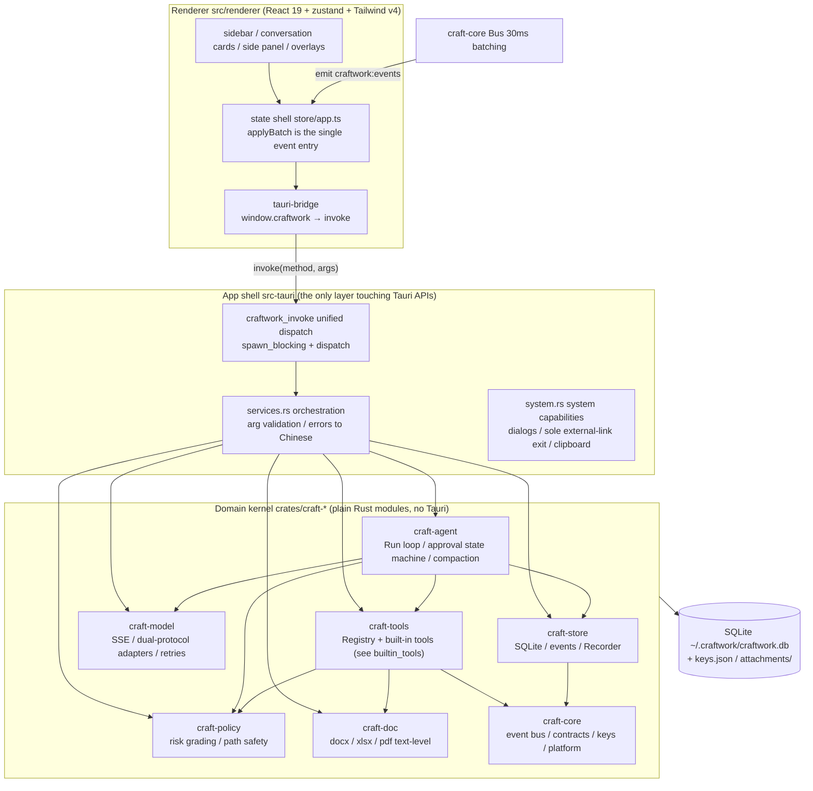
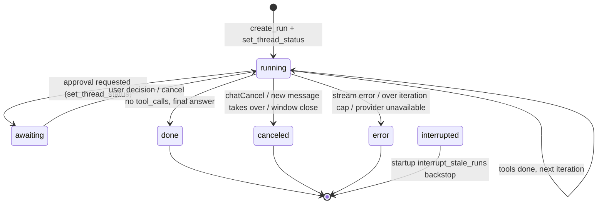
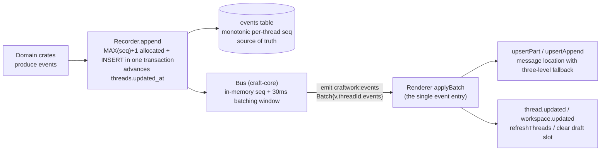
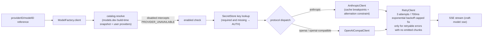

# CraftWork Architecture

This document is the architecture source of truth: layered structure, main business flows, the event pipeline, the security model, and the summary of historical decisions. Terminology follows the root [GLOSSARY.md](../GLOSSARY.md); development rules are in [AGENTS.md](../AGENTS.md); the ticket convention is in [docs/agents/issue-tracker.md](agents/issue-tracker.md). Feature-level behavior contracts live in each module's module-level comments (not restated here) — this document records only cross-module structure and trade-offs.

## 1. Positioning

CraftWork is a desktop agent: it reads files, edits code, runs commands, and processes documents on the user's machine. File writes, commands, and document edits go through approval first — a constraint that shapes the approval state machine (§3.3) and the security model (§5).

## 2. Layered Architecture



| Layer | Directory | Responsibility | Key constraint |
| --- | --- | --- | --- |
| UI | `src/renderer` | React UI; event-driven state shell | Holds no Node capabilities; colors via semantic tokens; system operations only through the channel table |
| Shared contracts | `src/shared` | `channels.ts` channel table, `events.ts` event contract, `types.ts`, `ids.ts` | Paired against `craft-core::contract` via the gold-master and dispatch tests to prevent drift |
| App shell | `src-tauri` | Window wiring, `craftwork_invoke` dispatch, service orchestration, system capabilities | The only layer allowed to import Tauri |
| Agent | `crates/craft-agent` | Run loop, approval state machine, grant cache, history rebuild, context compaction, auto-naming, prompt assembly, environment context | The run environment is a value (`RunEnv`), not global state |
| Tools | `crates/craft-tools` | `Tool` trait (spec + execute), Registry cross-cutting concerns (path resolution / output truncation / panic isolation) | Synchronous execution; the caller is responsible for spawning on a blocking thread |
| Policy | `crates/craft-policy` | Risk grading R0–R4, approval tiers, command classification, safe path resolution, sensitive attachment names | The tier is only an engine input and never changes risk grading |
| Model | `crates/craft-model` | Unified client: catalog snapshot, SSE, OpenAI/Anthropic adapters, retries, error normalization | Errors must map to error codes; raw HTTP errors never escape |
| Storage | `crates/craft-store` | SQLite open/migrate, threads/workspaces/events/runs/approvals, usage/settings, Recorder | seq allocation and insert share one transaction; the events table is the source of truth |
| Foundation | `crates/craft-core` | Event bus (30ms batching), contract types, IDs, atomic write/hash/env sanitizing/subprocess, keys, line diff | Depended on by every domain crate |
| Documents | `crates/craft-doc` | Text-level docx / xlsx / pdf read-write (low-level zip + XML) | Text-level: content only, never rebuilds layout |

Data directory `~/.craftwork` (isolatable via `CRAFTWORK_HOME`): `craftwork.db`, `keys.json` (0600), `attachments/`, `workspace/default` (built-in scratch session directory).

## 3. Main Flows

### 3.1 Sending a message (atomic first-send path + Run loop)

```mermaid
sequenceDiagram
    autonumber
    participant U as User
    participant C as Composer (conversation.tsx)
    participant SVC as services.rs
    participant ST as craft-store
    participant RN as Runner (craft-agent)
    participant MC as Model client (craft-model)
    participant BUS as Bus → emit

    U->>C: types and submits (Enter / button)
    alt draft first-send
        C->>SVC: chatCreateAndStart (atomic path, zero persistence on failure)
        SVC->>SVC: resolve(model_ref) model validation
        SVC->>ST: create_thread (short title, title_auto=true)
        SVC->>ST: recorder.append(user_message) write + broadcast
        SVC->>RN: runner.run(thread_id, trigger_seq)
    else idle send within a session
        C->>SVC: chatSend → append_user_message → runner.run
    else steering while running
        C->>SVC: chatSteer → runner.try_steer enqueue ("pending delivery" marker)
    end
    RN->>ST: create_run (pre-allocated reply anchor message_id)
    RN->>ST: snapshot + build_history rebuild
    RN->>RN: collect_env_context + build_prompt (three cache layers)
    loop each iteration (cap default 0 = unlimited, read live from settings)
        RN->>RN: consume steer queue: inject history + start new assistant message + steer.delivered receipt
        RN->>MC: open_session_with_failover → stream(request)
        Note over RN: first iteration: compaction check (70% threshold) + auto-naming (parallel)
        MC-->>RN: streamed chunks (text/reasoning deltas broadcast only, never persisted)
        BUS-->>C: batched events → applyBatch streaming render
        RN->>ST: reasoning/text parts persisted whole + record_usage
        alt no tool_calls — final answer
            RN->>ST: finish_run(done)
        else has tool_calls
            RN->>RN: run_tool one by one (see 3.2 approval flow)
        end
    end
    Note over RN: execute_run returns with has_steers → relay a new run to consume them; steers dropped at finish also get a steer.delivered receipt
```

Key points:

- **Atomic first-send path** (`services.rs::chat_create_and_start`): model validation happens first and any failure persists nothing; the sidebar and database therefore naturally have no empty sessions.
- **The user message is persisted before the Run starts**; a Run start failure after first-send does not roll back (the session is kept for retry).
- **One run per session at a time**: `Runner.run` cancels the old token before registering the new one (a new message takes over).
- **Failover happens only before the stream is established**: the candidate chain = primary model + fallbacks parsed from the `fallbackModel` setting; once a stream is established, errors no longer fail over (left to RetryClient's same-model retries).
- Four terminal states: `done` (complete) / `canceled` (cancel) / `error` (fail, error part persisted first) / `interrupted` (startup-time `interrupt_stale_runs` finalizes a run left unfinished by the last session).

### 3.2 Run state machine



### 3.3 Approvals and grants (three defense lines)

```mermaid
sequenceDiagram
    autonumber
    participant RN as Runner
    participant RG as Registry (craft-tools)
    participant PE as PolicyEngine (craft-policy)
    participant AP as Approvals (craft-agent)
    participant GR as Grants (craft-agent)
    participant ST as craft-store
    participant C as Renderer

    RN->>RG: assess(tool, args) read-only evaluation
    RG-->>RN: risk R0–R4 + prebuilt ToolCtx
    RN->>RN: emit tool.started (incremental, not persisted)
    RN->>PE: action(restricted, risk, level)
    alt Allow (R0 / free tier)
        RN->>RN: straight to execution
    else Deny (restricted R3 / destructive R4)
        RN->>RN: produce error ToolResult, no execution
    else Ask
        RN->>GR: allowed(tool, target)? grant cache lookup
        alt hit (scope=cache)
            RN->>RN: skip asking
        else miss
            RN->>ST: create_approval (decision IS NULL)
            RN->>ST: append(approval) persist card + set_thread_status(awaiting)
            ST-->>C: broadcast approval.requested → approval card
            RN->>RN: await oneshot (select! racing cancellation)
            C->>RN: chatDecideApproval(approvalId, allow, scope)
            RN->>ST: resolve_approval (WHERE decision IS NULL, concurrency-idempotent)
            RN->>GR: non-once grant → grants.grant register
            Note over GR: session stays in memory; workspace additionally writes the settings table<br/>allowPermanent=false / R3 / R4 / restricted are all treated as once
            RN-->>C: approval_resolved event updates the card
        end
    end
    RN->>RG: spawn_blocking(execute) (panic isolation + output truncation)
    RN->>ST: tool_call part persisted
```

The three defense lines are independent: tool-level argument validation; the policy engine deciding approval; and `craft-policy::resolve` path resolution rejecting out-of-bounds access (lexical checks + symlink real-path, double-checked; renderer-provided paths are untrusted). System temp dirs are an **implicit accessible root** on this boundary (D28): absolute paths may land there at the tool's base risk level, never escalated to R3 for being outside. Approvals require an explicit decision — no silent-allow path in the backend; a written decision is immutable; cancel, window close, and app exit all land as deny or cancel decisions on the `approvals` row.

### 3.4 Event pipeline (persist → batch → broadcast → apply)



- **Incremental events** (text.delta / reasoning.delta / tool.started) are broadcast only, never persisted; whole parts are what get persisted (reasoning / text / tool_call in terminal form).
- Persistence failures degrade to broadcast-only (`append_or_warn`) so the UI never freezes on storage faults.
- Snapshots and in-flight events merge: switching sessions pulls the full snapshot (authoritative order), while streaming-only messages append at the tail (`mergeStreamedMessages`).

### 3.5 Stop and cancel

- The stop button (armed double-confirm within 800ms) and double-Esc while running share the armed state; both go through `chatCancel` → `Runner.cancel`: the session's `CancellationToken` is taken from the in-memory cancels map and cancelled; stream consumption and approval waits observe it via `tokio::select!` and enter the `canceled` terminal state and approval-cancel teardown respectively.
- Window close / app exit: `on_window_event(CloseRequested)` and `RunEvent::ExitRequested` both call `cancel_all_runs` (cancel per session); async teardown left unfinished is marked `interrupted` by the next startup's `interrupt_stale_runs`.
- Steering: enqueued for later (capped at `MAX_STEER_QUEUE`), merged into the next model request after the current tool batch; if unconsumed steers remain when the run finishes normally, a relay run starts automatically.
- **Steer delivery receipts** (`steer.delivered`): every steering message gets a persisted + broadcast receipt when consumed (injected into history) or dropped at finish; the frontend removes the "pending delivery" marker (via) based on it — the marker's lifecycle is fully receipt-driven, and `run.started` no longer clears them wholesale (during a relay, queued steers are not yet consumed; clearing early would be wrong); snapshot rebuild also removes via by receipts (steering without a receipt still shows pending after restart). The consumption point also starts a new assistant message (`nextMessageId`): the timeline ordering and visual positions between later output and the steering bubble stay consistent, and the old message is sealed.
- **Steering acknowledgement** (D19): delivery also requires "acknowledge, then continue" — the round that merged steering must first emit a visible sentence stating what the input changed; if the model skips it, a reminder is injected at the next iteration, at most once per batch. A prompt-level soft constraint plus one correction, no hard gate. Implemented as the `steer_unanswered` / `answer_due` sentinels in `runner.rs` and the contract entry in `prompt.rs`.

### 3.6 Snapshot loading and drafts

- **Snapshot**: switching sessions → `threadSnapshot` → `craft-store::events::snapshot`: events read in seq order, messages and parts regrouped by messageId; approval state is backfilled from the approvals table's `decision IS NULL`; the runs table adds placeholder messages for runs without events (authoritative signal = `trigger_seq + 1`).
- **Draft slots**: session intents that have not sent a first message write nothing to the events table and appear in no session list; bucketed by "mode × workspace" into the single localStorage key `craftwork-drafts` (content survives restarts); deleting a project clears the matching slot via the `WORKSPACE_UPDATED{removed}` event.

## 4. Storage Model

SQLite (rusqlite bundled + WAL, single Mutex-serialized connection) is the source of truth; messages and parts have no copies — they are rebuilt from the events table.

| Table | Responsibility |
| --- | --- |
| `events` | Session events, `(thread_id, seq)` monotonic; writes happen inside one transaction (seq allocation and insert together) |
| `threads` | Session rows (title, status, title_auto flag, updated_at advanced by events); `parent_thread_id` non-empty marks a subagent thread (excluded from sidebar and search, deleted with the parent — D15); `agent_profile` holds the effective profile snapshot of custom subagents (V16) |
| `workspaces` / `workspace_folders` | Workspaces and multi-source folders (first is primary), trust tier (trusted / restricted) |
| `runs` | Run lifecycle (terminal status, reply anchor message_id, trigger_seq) |
| `approvals` | Approval facts (request payload + decision; `WHERE decision IS NULL` provides concurrency idempotence) |
| `plans` | Plan rows: approved flag and `file_path` for the persisted plan text (the compaction continuation source); created on plan-mode starts and auto-entered runs (D32), backfilled by `exit_plan` decisions |
| `marketplaces` / `skill_plugins` | Skill store facts: market sources, installed plugins with version pointers and retained versions (D12) |
| `usage` / `settings` | Usage (with cost estimates), settings (including workspace_grants) |

Schema changes only append versions to `MIGRATIONS` in `craft-store/src/db.rs`; released version semantics never change; bidirectional compatibility with the historical Node-era database is guaranteed by golden-sample pairing tests.

## 5. Security Model

| Mechanism | Implementation |
| --- | --- |
| Risk grading | R0 read / R1 workspace write / R2 execute / R3 network or out-of-bounds / R4 destructive; arguments can escalate risk |
| Approval tiers | graded / free; free is the only tier allowing everything and requires the "capability list + risk checkbox" gate to switch; tier changes take effect immediately. The historical strict/readonly tiers are removed and stored legacy values fall back to graded |
| Grant scope | once / session / workspace; `allowPermanent=false`, R3, R4, and restricted workspaces never get permanent grants |
| Restricted workspace | R3 rejected outright, R1/R2 ask every time, existing grants do not apply, no permanent grants |
| Path safety | `craft-policy::resolve`: lexical checks (out-of-bounds / backslash / double slash) → symlink real-path resolution → must land inside a workspace root; absolute paths may alternatively land in system temp dirs (implicit accessible root, D28, flagged by `Resolved::system_temp`) |
| Command execution | `shell_exec`: own process group, env stripped of secret-like keys by blacklist (keeping functional deps like `SSH_AUTH_SOCK`, D18), timeout kills the process group (including grandchildren), bounded output buffer + truncation; not an interactive terminal (removed, decision D1) |
| Keys | Stored only in the Rust process and `~/.craftwork/keys.json` (0600, corrupt file degrades startup); never into logs, the database, or the renderer |
| UI isolation | CSP + capabilities on; no remote pages; the only external-link exit goes through `open_external` validation (http/https) into the system browser; `on_navigation` blocks in-place navigation |
| Data protection | `expectedHash` on the editor save path blocks overwriting externally modified files; there is no pre-write backup (removed with `SCHEMA_V18`), so a mistaken write has no in-app rollback |

## 6. Model Access



- Providers and the model catalog come from `assets/catalog/catalog.json.gz` (a build-time snapshot of models.dev, embedded via `include_bytes!`); user-defined providers are stored in the `model.custom_providers` setting; the app ships no usable provider.
- User providers can configure custom headers (`PersistedProvider.headers`, e.g. gateway routing header `x-opencode-session`): attached to every model request / connection test / model fetch, validated server-side on save (names limited to RFC 7230 tokens, values must not contain newlines, `authorization`/`x-api-key` conflicting with the key field are rejected, deduped, capped at 16 entries / 4KB); the renderer's `lib/provider-headers` mirrors the same rules for instant feedback, with the server as the final authority. Header values support the `{sessionId}` placeholder — replaced at send time with the current session ID (`Request.session_id`, filled for the main conversation and the naming/prediction/compaction sidecars alike), giving per-session routing; requests without session context skip headers containing the placeholder.
- Error normalization: HTTP status codes → base error codes, then keyword-based second-pass correction (e.g. 400/401 can still be rate limits, in-stream errors carry no status code); the UI only sees codes like `auth / rate_limit / timeout / context_overflow`.
- The single source of truth for usage accounting is `craft-store::usage_stats` (shared by the runner's persistence and view projection): context usage = the **normalized full prompt of the most recent main-conversation request (including cache read + write, `Usage.prompt_tokens`, filled by each protocol adapter) + output**, overwritten (not accumulated) each turn (legacy rows without the normalized value fall back to `input + output`); the output-rate denominator is the generation window (stream end − first token, stored as `usage.gen_window_ms`), "hidden thinking" (reasoning tokens present but not streamed, e.g. OpenAI-style) falls back to the full duration, and an invalid window (canceled/failed turns, too short) is unrated and recorded as 0 — never presented as a real 0 tok/s; when a gateway provides no usage, no usage row is written (all-zero rows would poison the level/speed derivation), while partial usage on canceled/failed turns (Anthropic `message_start` already knows input/cache) is persisted as usual. History beyond 70% of the model window triggers compaction (checked every turn: the most recent measured `prompt_tokens` takes priority over the threshold, falling back to a character estimate; the estimate is CJK-aware — one Chinese character ≈ 1 token; the session's model generates the summary, persisted as a `context_summary` event, failures do not block).
- The system prompt's three cache layers: identity (no cache marker) / stable (identical across sessions) / dynamic (stable within a session), mapped to Anthropic prefix-cache breakpoints.

## 7. Architecture Decision Summary

Full background lives in the original ADRs and migration plans in git history (archived); what follows is the summary of decisions that still constrain development.

| # | Decision | Key points |
| --- | --- | --- |
| ADR-0001 | Deferred persistence for new sessions + draft slots | Creating is only a renderer draft; the first send atomically persists; sidebar and database naturally have no empty sessions; a Run start failure does not roll back (persisting the user message first is a repository principle) |
| ADR-0002 | Rebuild the desktop shell on Tauri 2 | Electron → Tauri 2: main-process domain logic rewritten in Rust, renderer kept as-is; the data layer is bidirectionally compatible for rollback; related decisions: remove the terminal, build the agent in-house, adopt the craft- prefix |
| D1 | Remove the terminal feature | No PTY/xterm; `shell_exec` keeps command execution; removes the WKWebView Chinese-IME risk and node-pty cross-platform packaging obstacles in one stroke; **do not reintroduce PTY-related code** |
| D2 | The agent side is fully in-house | References openai/codex design and engineering structure (not code copying); no rig / genai / goose; infrastructure crates (tokio, rusqlite, reqwest, etc.) still use mature third-party libraries |
| D3 | Crates carry the craft- prefix | The unprefixed `core` shadows the Rust built-in crate, breaking `::core::` absolute paths including derive macros (verified E0432) — a hard conflict with no workaround value |
| D4 | Side panel keeps the "Files / Documents" tabs | Structure unchanged after the terminal tab removal; "Files" is the default tab |
| D5 | MCP client (implemented 2026-11-08; the earlier "stubbed" note is revoked) | Settings → MCP manages servers (stdio / streamable HTTP / SSE transports); the protocol implementation uses **rmcp 3.9** (selection and dependency verification in D16); tools register into the Registry as `mcp__<server>__<tool>` and go through the existing approval / plan mode / Work mode chains; supports tools returning images (saved to the attachment dir → tool message attachments → protocol-specific projection to the model / thumbnails in the UI, see D16). **Not done**: OAuth, sampling, elicitation, resource subscriptions, MCP Apps, server instructions injection, auto-reconnect. See D16. |
| D6 | Unsigned builds first; updater not wired | tauri-plugin-updater is not introduced and there is no signing public key — only the settings field remains; a separate effort will wire it once credentials arrive |
| D7 | Only macOS is on-device tested | Win / Linux on-device walkthroughs are a separate effort (packaging obstacles from D1 are gone; configs are ready) |
| D8 | Plan mode = explicit protocol (enter_plan / exit_plan tools) + the approval card as the single approval entry (revised 2026-11-07: read-only gate and fallback banner removed) | "Plan mode" remains a per-message send option (the user_message payload's planMode, restored by the run from the trigger; regenerate follows the previous round and a steer relay takes the first steering message), not a session-level tier. The model can enter plan mode proactively via the `enter_plan` tool (R0, no approval; broadcasts plan.entered to sync the frontend toggle); after investigation it must submit the full plan via `exit_plan` (body in the plan argument, 1–20000 chars), and that tool **always requires approval** (the card appears even on the free tier) — the core boundary of plan mode. **Plan-mode permissions equal the approval tier** (2026-11-07 user ruling: approval consistency beats forced read-only; the original "R2+ rejected outright" gate was removed; the prompt's "investigation first, avoid implementing before approval" is a soft constraint). The plan-mode hard gate added in 31c4e88 (blocking all `mutates` tools under the graded tier) **applies only to the graded tier and is disabled on free** (2026-11-10 user ruling: free's meaning is allowing everything — `Engine::action` returns Allow for free before the restricted-workspace check, and the gate was once the only place that ignored the tier; a consistency ruling by tier semantics, not a special case for free). Three approval outcomes: approve → exit plan mode, persist the plan verbatim (approved=1, the compaction continuation source), the run keeps iterating straight into implementation; deny with feedback → stay in plan mode, the feedback becomes a real user message (via=plan_feedback) injected into history for revision and resubmission; deny without feedback (ignore) → stay in plan mode, plan persisted (unapproved), the run finishes normally. **The approval card is the single plan approval entry**: no fallback approval banner/card above the composer; the finalize-heuristic persistence and cross-run injection were removed with it (no protocol, no plan artifact). The approved plan's full text is injected at the head of history after compaction (kept). The frontend toggle state is session-scoped (threadComposer buckets), synced directionally by plan.entered (on) and the approval result (off); the card renders the plan as Markdown with `overscroll-contain` scroll isolation |
| D9 | Worktrees are orchestrated by the backend, bound per session | Checking worktree and sending makes the service layer's `ensure_thread_worktree` run git directly (platform::run, sanitized env + timeout tree-kill), not through agent tools/approval — it is a send-orchestration action before the run, and failures roll back preserving "zero persistence on failure"; the directory is fixed at `<data dir>/worktrees/<session id>` (isolated with CRAFTWORK_HOME), the binding lands in the threads table (V10) and the RunEnv primary folder switches so fs/commands/Git all follow; it cannot be unbound (avoiding a split between primary and worktree states), and deleting the session/project cleans up in cascade |
| D10 | Python batch operations = environment base + classification + prompt guidance + double guardrails | Supports the model using Python for batch file edits: ① environment base — `sanitize_env` specially allows `PYTHONIOENCODING`/`PYTHONUTF8` (user value first, else a UTF-8 default); ② classification — `python/python3/py` with only `--version/-V/-h` style pure queries is R0 read-only, `-c`/`-m`/script paths stay R2 approval, `pip install` stays R3; ③ guidance — the environment snapshot probes python3 (falling back to python) into "runtimes", the behavior contract gains the batch exception and the `-I` isolation clause for untrusted files; ④ guardrails — apply_patch failure text forbids pivoting to whole-file script rewrites, and **every** failure branch must carry that clause (2026-11-13 correction: the empty-hunks branch said only 「补丁中没有可应用的内容块」 with no format hint, so a bare `@@` header produced an unactionable error and the model pivoted to `python3 - <<EOF` within two retries; `parse_patch` now rejects any `@@` line that lacks the `@@ -a,b +c,d @@` range instead of silently dropping its body). The policy layer cannot see inside scripts (writes inside `python x.py` after approval are not path-checked — the same boundary as shell, backed by prompt constraints; the audit-log backstop this clause originally assumed was removed with `SCHEMA_V18`). Deterministic built-in scripts/skills were chartered by D11 |
| D11 | Skills = user-level + workspace-level SKILL.md directories + two-layer loading + explicit slash invocation | Four-level directory priority (`~/.craftwork/skills` → `~/.agents/skills` → `<workspace>/.craftwork/skills` → `<workspace>/.agents/skills`; `.agents` for ecosystem compatibility; first scanner wins, deduped by SKILL.md path, same name first-found wins; recursion depth 8). Two-layer loading: every run rescans and injects the "available skills" listing (20K-char budget, degrade to names only when over) → the model calls the `skill` tool (R0, available in Work, loads by name without taking a path) to read the body (wrapped in `<skill_content>` + base dir + `${CLAUDE_SKILL_DIR}` substitution; loading rescans, disable/delete take effect next run). Disable persistence in `skills.disabled` (array of absolute SKILL.md paths) + master switch `Settings.skillsEnabled`. Restricted workspaces do not scan workspace-level skills (automatic surface); explicit slash invocation is unrestricted (user-initiated, loading is R0, subsequent commands still go through approval). Slash invocation goes through prompt rewriting (same structure as slash commands): the raw text is kept in persistence and the message stream (`skillInvoke` payload + capsule styling) while the model history is replaced by a steering prompt of "call the skill tool first, then execute" (history rebuild and steer delivery both go through `manual_skill_prompt_from_text`); non-matching input sends as a normal message. The frontmatter parser is hand-written flat YAML (no yaml dependency). The management page shows the full grouped listing (user-level + each workspace, with ownership, no workspace selector; the management listing and the in-session completion listing are separate slots). Loading rules: `crates/craft-tools/src/skills.rs` module header. |
| D12 | Skill Store = market plugin distribution + versioned cache pointers + three-form manifest detection | A market source = a user-added git repository (**no source is pre-configured**; the build embeds 5 recommended source candidates for one-click add: superpowers / mattpocock/skills / ponytail / anthropics/skills / rampstackco/claude-skills). Manifest detection in order: `.craftwork/marketplace.json` (first-class) > `.claude-plugin/marketplace.json` (read-only compatibility) > bare `.claude-plugin` / `.codex-plugin` `plugin.json` (single-plugin repo wrapped into a single-plugin market) > bare `skills/` directory (implicit plugin); supports entry-level `skills` arrays (strict:false, the anthropics/skills form). Commands inside a plugin map to skills; hooks / agents / mcpServers are parsed for the detail page only and never loaded — hooks are almost all Node scripts (CraftWork has no Node runtime), so plugins with hooks degrade to on-demand / slash activation (stated on the detail page). Cache at `~/.craftwork/skills-marketplace/cache/<market>/<plugin>/<version>/` (immutable multi-version; staging → SQLite pointer transaction → rename atomic activation, the pointer is authoritative, startup cleans leftovers; 3 versions retained, one-click rollback on the detail page). New SQLite tables `marketplaces` / `skill_plugins` are the source of truth; versions resolve plugin-manifest `version` > entry > git sha, and update detection is dual-axis (semver first, sha fallback, never guessing). Scan integration: `SkillSource::Marketplace` is the fifth root ordered after manual skills; plugin skills use the qualified name `plugin:skill` (bare name as alias, manual wins same-name conflicts, same-name across plugins fails closed); **plugin-domain scans do not follow symlinks**; plugin-level enable state lives in the tables, per-skill disables reuse `skills.disabled`. Downloads go over gix **via `craft-git` (the D13 unified site)**. Timing: every run rescans; install / upgrade / rollback / disable / uninstall take effect in the next conversation turn (hot reload). Store UI = Settings→Skills with two tabs (local skills + skill store: source management bar + recommended-sources block + plugin cards / detail + update badge), throttled refresh on entering the page (10-minute window), no background polling. Install / upgrade / rollback / uninstall / source management are all direct user operations; the agent cannot install skills (`skill_install` deferred). Cache and pointer semantics: `craft-marketplace` module headers. |
| D13 | Git capability unified on gix (craft-git): in-app git no longer depends on system Git (2026-11-07 user ruling for full migration; the engine was verified as single-engine via source inspection) | New crate `crates/craft-git/` centralizes the gix (gitoxide) dependency — **gix is touched only by it**, collapsing the 0.x upgrade surface. Six call sites migrated: the four git_* tools (shell.rs), envcontext git summary, sidebar `workspace_git_statuses`, `user_display_name` (platform.rs), the D9 worktree (services.rs), and the D12 store downloads. **Selection verification record**: early secondhand material claimed gix's write paths had no high-level APIs; local source inspection (gitoxide HEAD `bc4d81353`) overturned that — `repo.commit_as` (objects + ref transaction + reflog in one step), `add_worktree` / `remove_worktree`, `UnifiedDiff` (standard `@@` hunk rendering), and the full shallow suite (depth/deepen/since/exclude) are ready-made APIs; the real gaps were index→tree conversion (replaced by `TreeEditor::upsert`), patch file-header assembly, and worktree prune — three pieces of deterministic glue; a git2/libgit2 hybrid therefore lost its advantage (zero C deps, zero openssl, TLS unified on rustls). **1:1 behavior alignment is a hard constraint**: tool arguments / output formats / risk levels / error messages take the existing implementation as baseline, status / log / diff are gold-tested against system git output (fixture matrix), GitCommit's two modes (path-scoped add+commit / `-am` over tracked files) and identity cascading (config snapshot for user.name/email) are preserved item by item; degradation behavior is preserved (envcontext failure omitted, sidebar empty string, display-name fallback chain); worktree **interop acceptance** (gix-created worktrees recognized by system git's `worktree list`, both directions). Shell semantics do not migrate: `craft-policy::command`'s git command classification and git commands the model / user run via shell_exec keep the user's machine git. Milestones: M1 base → M2 transport (serving D12 first) ∥ M3 read-only → M4 diff → M5 commit → M6 worktree + cutover. Known deviations: `crates/craft-git` module headers and the feature comments in its `Cargo.toml`. **Line-ending normalization on commit (2026-11-12)**: `git_commit` runs worktree files through `gix::filter::Pipeline` for EOL normalization (`.gitattributes` `text` / `eol` + `core.autocrlf`) before writing blobs — previously bytes were written verbatim, so Windows checkouts (CRLF) committed CRLF verbatim, producing "changed one line, rewrote everything" fake diffs in history (`.gitattributes` only normalizes the index side and cannot fix already-written blobs). The attribute source must be `WorktreeThenIdMapping`: a `.gitattributes` added by this very commit is not yet in the index, and `IdMapping` would miss it, silently disabling attributes like `-text`. `CommitOutcome` also gained `committed_files` / `leftover_files`: path-scoped commits only commit listed paths and leave the rest in the worktree with the index untouched (correct git semantics), but without reporting counts callers read "commit succeeded" as "everything committed" — this defect actually happened once (1 of 6 files committed). See `crates/craft-git/src/commit.rs` module header "what goes into a blob". |
| D14 | Unified network exit: three-mode proxy + GitHub acceleration; every outbound request follows one network config | Settings → Network: `proxyMode` = system (default) / none / custom + `proxyUrl` (http/https/socks5/socks5h; reqwest gets the `socks` feature; no scheme defaults to http); `craft-core::network` is the **single resolution point** — none = reqwest `no_proxy()` + gix `proxy: Some("")` (all disabled); custom = explicit `Proxy::all` + gix `Options.proxy` with **built-in fixed local exclusions** (localhost / 127.0.0.0/8 / ::1 / 169.254/16 / 10/8 / 172.16/12 / 192.168/16, protecting local model endpoints, not configurable) applied to both exits; system = **the app reads the system proxy** (macOS system-configuration/SCDynamicStore; Windows per D7) and feeds both exits explicitly, priority env > OS settings > direct — **reqwest's `system-proxy` feature is not enabled** (gix never reads the system proxy; the app reading it and feeding it explicitly is the only way to unify semantics). Proxy URLs with credentials are stored in plain text in the settings table (noted in the UI). **GitHub acceleration**: a switch (default off) + prefix URL (default `https://gh-proxy.com/`, replaceable with any prefix-style service); github.com / raw.githubusercontent.com requests are rewritten to `prefix+original` (git smart HTTP, releases/raw/archive under the same rule; reused when the updater D6 is wired); rewritten requests still obey the proxy mode, and **acceleration failure falls back to the original URL and retries once** (acceleration first, proxy as fallback). Five build sites wired (craft-model anthropic/openai/factory + services provider_test / fetch_models); timing = the next network request (clients are created per run / per call, no restart needed). The in-section inline "test connection" no longer reuses provider_test (since 2026-11-07 it is a public-endpoint reachability probe, see D14 revision 6). Any new outbound request must go through `craft-core::network`, no bypassing. **Unified outbound UA (2026-11-11)**: `APP_USER_AGENT` = `CraftWork/<version>` (version from the workspace version), injected by the two reqwest exits (`apply_reqwest` / `apply_reqwest_blocking`) after proxy assembly — call sites no longer set their own; user-configured custom headers for providers / MCP still win at request level. A known gap is the gix transport: gix-transport hard-writes the request-level `User-Agent: git/oxide-<ver>`, client-level default headers cannot override an already-formed header, and the only request-level hook `configure_request` makes gix refuse to follow redirects (`http://` 301 upgrades and `owner/repo → owner/repo.git` 301s both rely on it), so `Options.user_agent` only records intent while the actual value stays gix's — documented in `crates/craft-git/src/transport.rs` module header. Resolution point: `crates/craft-core/src/network`. **"Test connection" fixed rows (2026-11-11 revision)**: the network page's nine probe targets are now **rendered fixed on entering the section** (the single source is a new read-only channel `networkProbeTargets`, sharing `services.rs`'s `probe_targets` with the probe); the probe only updates one row's status cell — **no row insertion/removal, no whole-list replacement**; in-row running states are plain text, and only the button keeps a shimmer. Root cause: on-device, one row was repainted a dozen-plus times with button and row states contradicting each other (paint ghosting; neither the data layer nor frontend state could produce it — the embedded bundle and backend manifest were checked layer by layer), and "an empty-state `<p>` swapped wholesale for 9 rows + 9 `background-clip:text` shimmers animating at once" was the most suspicious trigger. Judgment: any HTTP status counts as reachable; DNS failure / connect failure / timeout count as failure. |
| D15 | Subagent system = sub-sessions + the same Run loop + four flat tools (2026-11-08) | The **sub-session route**: subagents do not get a second loop — a **sub-session is a `threads` row with non-empty `parent_thread_id`**, and `Runner` gains `RunKind::Sub(spec)` so main sessions and subagents share `execute_run` — events / snapshots / compaction / usage / session logs are reused wholesale, diverging in seven places (prompt, tool surface, plan protocol, auto-naming and input prediction, approval placement, finish). Model-visible tools are four flat tools `agent_spawn` (R0) / `agent_wait` (R0) / `agent_list` (R0) / `agent_close` (R1), all unavailable in Work; foreground returns the conclusion synchronously + a usage footer, background returns an immediate start receipt and injects the report into parent history at terminal state (next iteration while running, same place as steer; when idle, a `via=subagent_report` anchor message plus auto-wake) — **the default form was flipped by D31 (2026-11-12): omitting `run_in_background` means background; foreground is an explicit choice**. **No recursion**: the subagent tool surface strips all `agent_*` and `enter_plan`/`exit_plan`; the `agent_depth` column exists but is always 1 in phase one. Two built-in types: `general` (everything minus protocol tools) and `explore` (read-only allow-list: fs_list/fs_read/fs_glob/fs_grep/git_status/git_diff/git_log/doc_read/todo_write/skill); `explore` does not get AGENTS.md bodies to save tokens. **No custom permission system**: subagents go through the policy engine and approval tier per tool like anyone else; the approval card's thread_id/message_id use the parent session (the user decides in one conversation), the run_id is the child run (traceability), the card title is prefixed "subagent <name>:", the grant cache is shared with the main agent, and restricted-workspace rules are unchanged. Cancel cascade: stopping the parent cancels all its running subagents; stopped by the model's `agent_close` records `closed`, interrupted by the parent records `interrupted`. **Events and parts**: `subagent.updated` (persisted as kind `subagent`); a partId's running → terminal events merge into one card in both snapshot rebuild and the renderer. **Restart recovery**: startup `stale_subagent_events` backfills interrupted terminal states onto still-running cards (no wake), leaving no zombie cards. **Phase two, not done**: agent_send resume, fork full-history inheritance, Markdown custom agent definitions, worktree isolation, remote execution, agent teams/swarms, per-agent budgets and permission overrides. Implementation: `crates/craft-agent/src/subagent.rs` and `craft-tools/src/agent.rs`. **Panel addendum (2026-11-09)**: mid-run progress observability — each completed tool call appends an intermediate event to the parent under the same partId (iterations / tool counts advance live, still merging into one card); the frequency is per-tool-call rather than per-iteration — iteration granularity is too coarse to show progress, and if event volume grows the fallback is lower frequency with the payload contract unchanged. Iteration policy moved from a 100-iteration hard wall to "soft-cap wrap-up + 500 hard cap" — at ≤20 remaining, a visible notice is written to the sub-session and a wrap-up instruction injected into the child history (same place as report delivery), with cap-failure messages stating "used N of M iterations". UI placement: `panel.tsx` and the pane state in `store/app.ts`. **Wait boundary (2026-11-10)**: `agent_wait` waits only for subagents dispatched by `agent_spawn`, never background tasks (the latter notify on completion automatically — no waiting tool needed); with nothing to wait for it returns a readable error (`subagent_not_found`) instead of silent success — returning success once made the model treat background tasks as subagents and idle-wait repeatedly while the UI showed "completed". Terminology is strict: "background task" means shell background commands only, and subagents are never called "background subagents" (see GLOSSARY). The boundary is spelled out in three model-visible texts: the background-task contract line, the dispatch clause, and `SPAWN_STRATEGY`. |
| D15 extension | Subagent configuration split + custom subagents (2026-11-08) | **Config split**: subagent configuration moved from `Settings` into two settings keys — `subagent.config` (switch / concurrency / built-in types' default model and iteration cap) and `subagent.profiles` (the user's custom definition array). Rationale: `Settings` is a flat structure returned in full, so stuffing a definitions array into it would rewrite every definition on a theme change; same precedent as `model.custom_providers` / `skills.disabled`. The old fields `Settings.subagentsEnabled` / `subagentMaxConcurrent` are kept one version for **one-way fallback** (when the new keys are empty they initialize from the old ones once, then only the new keys are read/written). **Custom subagents**: users can add/remove definitions (name / description / role prompt / tool surface / model / iteration cap), selected by name as `agent_type` at dispatch. Resolution is unified as `ResolvedProfile` (`subagent::resolve_profile`): built-ins → built-in profile + adjustable defaults; enabled custom → the definition; no match → readable error listing available names. **Three-level model fallback** (tool arg > profile > parent session) and **profile-overridable iteration caps** (`iterations_for_profile`, clamped ≤ the ceiling; the ceiling constant is currently 500, see the D15 panel addendum). **Tool surface in three tiers** (`readOnly` / `all` / `only`) rather than free checkboxes — the read-only constraint is explore's safety property and casually adding `shell_exec` breaks it; every tier strips `agent_*` and plan-protocol tools. `agent_spawn`'s `agent_type` enum and the custom listing are generated per tool-surface assembly (`spec_with_types`), and the subagent prompt never shows the listing (no recursion). **Profile snapshots**: `threads.agent_profile` (V16) stores the effective profile JSON so historical sub-sessions can still explain "what it ran with" after definitions change. Settings gains a dedicated "Subagents" section (the two controls moved out of "General"). See the D15 extension and `subagent::resolve_profile`. |
| D16 | MCP client selection (rmcp) + tool image projection (2026-11-08) | **① The protocol layer introduces rmcp 3.9** (the official MCP Rust SDK; features: client / transport-child-process / transport-streamable-http-client-reqwest / reqwest): protocol codec, initialize handshake, tools/list, and tools/call are all the SDK's job — no hand-written JSON-RPC. **Dependency verification (first implementation step, measured)**: rmcp 3.9 depends on reqwest **0.13.2**, the same line as the workspace's existing reqwest 0.13 — no second dependency tree; `process-wrap 10` (process groups) is the same crate rmcp's child-process transport uses. **Threading model**: the tool layer is synchronous `Tool::execute` (the Runner uses spawn_blocking) while rmcp is an async SDK — `craft-mcp` bridges with a **dedicated OS thread + single-threaded tokio runtime + an mpsc command loop**, keeping async objects inside the thread to avoid the panic risk of `block_on` nesting runtimes on a blocking thread. **Remote transport uses a self-built reqwest client** fed to rmcp (`StreamableHttpClientTransport::with_client`): rmcp's `from_uri` builds its own client and bypasses the proxy, so explicit injection is required to honor D14's "all outbound requests follow one network config". stdio subprocess env = `sanitized_env` + **user-declared env** (declaring it is the authorization; MCP servers authenticate via `API_KEY`-style variables, and a pure allow-list would break most servers); own process group + stderr drained (not reading it deadlocks logging-style servers when the pipe fills), last 4KB of stderr into the app log. **② Tool results support images**: `ToolResult` gains `media: Vec<ToolMedia>` (base64 + mime, built-in tools unchanged); MCP `image` blocks pass a budget gate (png/jpeg/gif/webp, 5MB per image, 4 per result; over-limit degrades to a text placeholder) → the Runner saves to the attachment directory (event payloads record only file names; base64 never enters the event store) → attached to the tool message `attachments` → adapters project per protocol: **Anthropic `tool_result` content becomes an array and image-first (images before text)** — compatible gateways parse only a leading run of image blocks and silently drop text that precedes images (on-device pitfall, pinned by a unit test); **OpenAI-style tool messages stay plain text with the image deferred as a synthesized user message immediately after** (never persisted, exists only in request projection); `caps.vision=false` never sends images, only placeholders (unit-tested that base64 does not leak). History rebuild restores images by file name, otherwise the model cannot see the previous turn's screenshots from round two on. **③ Configuration model**: settings key `mcp.servers` (array of objects); D5's stub data (name/command/args only) auto-upgrades by "has command → stdio"; credentials are stored in plain text in settings + the UI never echoes them (`MCPServerView` returns only envCount/headerCount, same precedent as the D14 proxy). See D16. |
| D17 | Sidebar widths are adjustable = session-scoped posture, not persisted (2026-11-09) | Both sidebar widths are draggable (left `clamp(200,480)`, right `clamp(280,760)`, conversation column minimum 320px), but **nothing is written** — no SQLite, no ui.json, no localStorage; restarts return to defaults (left 264 / right 380). **Criterion**: font size is a **preference** (how you want the app to look — worth remembering); rail width is a **posture** (how you happen to be sitting — not worth remembering) — consistent with "window size is not remembered" (no `tauri-plugin-window-state`; `tauri.conf.json` fixes 1440×900); if the window size is not remembered, remembering rail width alone is half a posture, which is stranger. **Martyr record**: both storage designs were evaluated and rejected — ① stuffing `Settings` (the `settings` table's `app` JSON blob) ② a new `<data dir>/ui.json` UI-state channel; the rejection was not cost (neither needs migration) but "a persistence channel serving one consumer is a liability; serving five makes it infrastructure". **Cleaned in the same batch**: the legacy `Settings.panelWidth` field was deleted — never consumed by any layout, default 320 while the actual render was always 380, and `Settings` has no `deny_unknown_fields` (leftover keys are ignored at deserialization, so no migration was needed). **Reserved**: if postures are ever remembered, use `tauri-plugin-window-state` + one unified ui-state — **never scattered fields**. **Implementation constraint**: while dragging only CSS variables are written, never React state (per-frame setState would re-render the whole `<App>`, and the conversation stream is the heaviest subtree); rail width has a single source (`style` + variable; no hard-coded px widths or zeroing classes in class names — same-property utility classes are decided by Tailwind output order, which once caused "⌘B collapse left 264px of layout"). Implementation: `src/renderer/src/lib/resize.ts`. |
| D18 | Shell environment = user-selected shell + runs its startup profile + blacklist stripping (2026-11-09) | The command subprocess environment moved from an **allow-list** to a **blacklist**, and the selected shell's startup profile (`.zshenv`/`.zshrc` style — rc files in Unix jargon) is executed per the user's choice. **Motivation**: the allow-list only let through 12 variables, hiding node/cargo/pnpm from user shell configs and forcing "absolute-path workarounds" around toolchain management (in practice writing the registry to the wrong place and re-downloading hundreds of MB). **Capture**: config files are not statically parsed (`.zshenv` can source / branch / command-substitute — static parsing only yields hallucinations); instead a minimal baseline environment runs `<shell> -l -i -c '<marker>; env -0; <marker>'`, parsing only the NUL output between the two markers (dropping startup banner noise; values with newlines still parse correctly); a 5s timeout kills the group, results cache 30 minutes (raised from 5 minutes on 2026-11-10: 5 minutes is too short for one long run), and **expiry never returns empty-handed** — `current_vars` reuses the previous values, with consumers calling `ensure_fresh` (foreground/background `shell_exec`, before MCP stdio assembly) re-capturing only when expired; failures keep the old values without blocking commands (the original returned `None` on expiry, so commands late in a long run silently fell into the minimal environment — observed losing `CARGO_HOME` and writing caches into home). **Strip rules**: suffixes `_KEY/_TOKEN/_SECRET/_PASSWORD/_PASSWD/_PASSPHRASE/_CREDENTIAL(S)/_PRIVATE_KEY/_ACCESS_KEY/_ACCOUNT_KEY`, high-confidence substrings (`API_KEY`/`AUTH_TOKEN`/`CLIENT_SECRET` etc.), vendor prefixes (`AWS_`/`GITHUB_`/`OPENAI_`/`ANTHROPIC_`/`AZURE_`/`HF_` etc.); **keep exceptions** `SSH_AUTH_SOCK`/`GPG_AGENT_INFO`/`DBUS_SESSION_BUS_ADDRESS`/`SESSION_MANAGER` — without them git over ssh breaks outright. **Deliberately not used**: bare `TOKEN`/`AUTH`/`SESSION` fuzzy matches — they would kill the functional dependencies above; the interception scope must be explainable item by item. The single rule copy is `craft_core::shellenv::is_sensitive_key`, shared by four paths: `shell_exec` (foreground + background), runtime detection, and MCP stdio. **Prompt**: injects the shell path + family, the config files actually read, and the sanitized variable **names** (capped at 40 + total) — **never values**; values may hold uncovered credentials and prompts go to the provider; for values the model makes `shell_exec` echo them itself (through approval). **Default login shell**: only a fresh data directory (settings never saved) picks from `$SHELL` candidates; saved settings always run as stored (empty `shellPath` = explicit "none"), and upgrades never change the user's choice. **Known concession**: a blacklist is weaker than an allow-list; the defense = high-confidence rules + names only + a persistent UI warning + explicit user choice; the app's own keys were never in the environment (`keys.json` is Rust-side only) — this rule guards keys users export in their own startup profiles. Implementation: `crates/craft-core/src/shellenv.rs`. |
| D19 | Steering acknowledgement = prompt soft constraint + one correction, no hard gate (2026-11-09) | Motivation: steer's existing semantics covered only **delivery** (enqueue → inject at next iteration start → remove the "pending delivery" marker), not **acknowledgement** — after steering was merged the model could keep calling tools until `tool_calls` ran empty, leaving the user unable to tell whether the input was adopted. **Ruling**: acknowledgement = the round that merged steering first emits a visible sentence (one confirmation + one "therefore next…"), stating reasons when not adopting; a batch merges into one sentence, conflicts resolved by the last. **Intensity layering**: the system prompt `CONTRACT_LINES` is the main path; when the Runner detects "this round merged steer / plan_feedback but produced no text" it injects one user-message reminder at the next iteration start (at most once per batch, then lets go). **Rejected alternatives**: ① a hard gate (force re-requesting until text appears) — hands control flow to text detection and costs a full round trip per violation, while empty text has no correctness consequence; ② a dedicated "received" receipt part — downgrades acknowledgement to a mechanical receipt and touches the event contract, snapshot rebuild, and rendering; ③ a dynamic-block switch (reusing plan_nudge's `need_rebuild`) — the on-this-turn/off-next-turn flip rebuilds the prompt twice, busting the cache prefix; ④ judging non-acknowledgement by text length — would penalize legitimate short replies like "got it, continuing". **Boundaries**: steering never interrupts an in-flight stream or tool batch (preserving the tool-call pairing invariant) — the earliest effect is the next model request; to stop immediately use the stop button; the first round of a plain send gets no mechanism detection (calling tools immediately in round one is normal); subagent reports and background notifications are system-injected and require no acknowledgement. **Known blind spot**: a turn that merged no steering and ends with empty tool_calls is not covered (`runner.rs` goes straight to `complete()` on `tool_calls.is_empty()`) — an empty reply has no correctness consequence and is not worth an extra round trip. Implementation: the steering branches in `crates/craft-agent/src/runner.rs`. |
| D20 | System tray = background presence + light state (2026-11-10) | **Scope**: macOS + Windows supported; Linux out of scope this phase (D7). **Window lifecycle**: closing the window hides to tray by default (`CloseRequested` → `prevent_close` + `hide`) without canceling runs / background commands / MCP; `Settings.quitOnClose` (default false) restores the old semantics, where closing cancels + shutdown. Minimize keeps system behavior and does not enter the tray. ⌘Q / tray "quit" always go through the existing `ExitRequested` shutdown; tray quit shows no confirmation dialog, and menu items carry counts while running / approval-pending. macOS keeps the Dock icon and `RunEvent::Reopen` restores the window; no activation-policy switch. **Single instance**: `tauri-plugin-single-instance` registers first — a duplicate launch raises and focuses the existing window (un-hide show, unminimize), creates no session, and ignores command-line arguments. **Tray interaction**: left-click toggles visibility on both platforms, right-click opens the menu (macOS does not follow the left-click-opens-menu convention). The menu has four items: a read-only single-line status (`idle` / `N running` / `M pending` / combined) → separator → dynamic "show / hide main window" → "Quit CraftWork (count suffix)"; text updates in place via `MenuItem::set_text` (Tauri 2.12 has no `set_visible`, so the menu is not rebuilt). **Status semantics**: deduplicated by main session; running = has an unfinished run (including awaiting approval; subagent runs count toward the parent), pending = distinct `thread_id`s with `approvals.decision IS NULL`; background command tasks are not counted; refreshed once at startup, then on bus `thread.updated` debounced 100ms — no polling. **Icons**: Windows has normal / alert 32px icons, switching to alert when pending > 0 (plain red dot, no number); macOS always a 44px template icon with no tray red dot. **macOS Dock badge**: the renderer's `unreadTotal` extends to the deduplicated main-session count (non-archived) of "`hasUnread` or `status === 'awaiting'`", written through the existing `setBadgeCount`; no second badge. **First-hide notice**: a per-process "still running in background" system notification, gated live by `Settings.notifications`. **Degradation**: if tray creation or icon decoding fails, close-to-tray is disabled (close means quit) and the app starts normally; status query failures keep the previous text. **Not done**: launch at login, tray quick actions, minimize-to-tray, background task counts, animated / numeric badges, a macOS tray red dot, command-line arguments. Scope and degradation: `src-tauri/src/tray.rs` module header. |
| D21 | wait tool = an event- and user-interruptible timer wait, replacing sleep (2026-11-10) | Model-visible tool `wait` (R0, unavailable in Work, title "Wait"): sleeps `duration_ms` (clamped 1s–600s, default 30s) and returns normally; while waiting, a background task completing / a subagent reporting / arriving steering each **return early stating the wake source**; the user can "skip wait" on the wait row in the UI (the `chatCancelWait` channel: no approval, rejected when nothing is in flight). **Three disciplines**: ① event wakes report only the wake source — event bodies still go through the single existing injection point (next iteration start); wait carries no body, so the "tool call → tool result" pairing discipline of notifications / reports / steer is preserved; ② both user skip and session stop persist wait as the neutral state `canceled` (an **exception** to the general "cancel means discard" semantics — pure timing has no side effects, and the trail fixes a fake spinner on cancelled tools), the run continues, and the model uses the cancel text (including the `purpose` argument) to immediately re-verify the wait purpose and not wait again; ③ **do not use wait for background tasks** (end the turn and wait for the notification) — wait is only for short purposeful waits (rate-limit backoff, service readiness, retry intervals), strictly distinct from `agent_wait` (subagents only); no "background subagent" exists in terminology. **Implementation**: the Runner's async branch `run_wait_tool` — ordinary tools finish on spawn_blocking before checking the cancel token, so waiting must respond immediately: a 100ms select loop polls the cancel token / skip flags (a `wait_skips` flag set rather than a channel, avoiding a Notify permit race) / three event queues (`has_steers` / `has_notifications` / `has_reports`, gated by the same kind.is_main() as each injection point); the registry's thin-shell `execute` mirrors the agent.rs protocol tools. **Companion**: `shell_exec` pre-rejects sleep commands (first-word check — rejected even within budget and even with `run_in_background`, with copy steering to wait / run_in_background); with the pre-rejection in place the old "foreground timeout sleep exception" is unreachable and kept only as a backstop against two predicate sites drifting; the corresponding "timeout hard-fail" test was deleted. The behavior contract gained a wait discipline clause, and three places state "do not use wait / agent_wait to wait": the background-task clause, the `ShellExec` description, and the background start receipt. Implementation: `crates/craft-tools/src/wait.rs` and `craft-agent::runner::run_wait_tool`; terminology in GLOSSARY "wait tool". |
| D21 | Tool-card change diffs = write-side line diffs + the UI reuses the body's shiki coloring (2026-11-10) | After successful write tools (`fs_write` / `fs_edit` / `apply_patch`), the result's `meta.diff` carries a line diff promoted to the top level of the `tool.completed` payload; the conversation's tool card renders it on expand and shows `+N −M` collapsed. **Why compute on the write side instead of the UI**: the UI has no "before" text (the original is not persisted anywhere and paths do not ride on events), so recomputing later would be guesswork; the write side has old/new in hand, and the diff must ride the event for history browsing anyway. **Three trade-offs converge in `ToolCtx::attach_diff`**: ① equal old/new writes no field (the UI distinguishes "no change" from "zero stats"); ② serialization over 64KB degrades to pure stats (`hunks` emptied + `truncated`) — diffs ride events, and one huge change must not bloat the events table; ③ binary originals produce no diff (no line semantics), and new files count as whole-additions against an empty old. `apply_patch`'s diff recomputes "original before → full after" rather than stitching patch text: patch line numbers can carry offsets, and what actually changed is what landed on disk. **Coloring** reuses the body's shiki with the `github-light` / `github-dark` themes (shiki was hoisted from a `@streamdown/code` transitive dependency to a direct one — same package, no new tree), tokenizing the whole snippet then splitting per line — per-line highlighting loses cross-line syntax state (template strings and block comments color wrongly); the theme follows `themeResolved`, so theme switches apply instantly without following the system. **Bounded rendering**: at most 400 lines per diff + container max-height with horizontal scroll; coloring failures silently degrade to plain text (the diff is information; color is enhancement). **Old events are not backfilled**: history without a `diff` field keeps the original plain-text output. **Not done**: auto-scroll to the first change, side-by-side view, per-hunk collapse inside a diff, coloring `git_diff` output, or `doc_edit` / `xlsx_set_cell` (they edit document-internal XML where line diffs are meaningless). Boundaries: `ToolCtx::attach_diff` in `crates/craft-tools/src/registry.rs`, `src/renderer/src/components/tool-diff.tsx`, and the `src/renderer/src/lib/code-highlight.ts` module headers. |
| D22 | Windows custom title bar = inline-migrated custom controls + panel-flush caption row (2026-11-11; the tauri-plugin-decoration overlay plan was revoked) | On Windows the window runs `decorations: false` (`src-tauri/tauri.windows.conf.json`); minimize / maximize-restore / close come from the renderer's `WindowControls` (`src/renderer/src/components/window-controls.tsx`), **inline-migrated** — the controls are ordinary flex children embedded at the right end of whichever surface owns the top-right corner, genuinely migrating with panel state: panel closed → the session header's right end `[expand sidebar][─][□][✕]`; panel open → the panel tab strip's right end `[collapse][maximize][─][□][✕]`; inlined at the top of the settings overlay; absolute at the image preview's top-right (window controls must stay operable above the full-page overlay; the palette transient does not). macOS has no inline controls (native traffic lights top-left) — only expand/collapse and the maximize button migrate with panel state. Close follows the existing `CloseRequested` → "close to tray" (D20). **Controls inline their own space, no blind-zone filler** (the revoked overlay plan required each surface to reserve a 174px yield variable and pinned buttons over app elements — the reason for revocation). **Panel-flush caption row**: `#content` has no `pt-2` (conversation cards carry their own top margin); the panel tab strip h-12 sits at window y 0..48 alongside the controls; strip children are drag regions (`data-tauri-drag-region="deep"`) — gaps drag the window, double-click maximizes, clickable elements are auto-excluded by drag.js. **The side panel is not resident**: with the panel closed the renderer mounts null (the old 36px icon rail is gone); the open entry is the toggle at the session header's right end (with a subagent running badge, `hooks/running-subagent-count.ts`). **Known trade-offs**: custom buttons lack Win11 Snap Layouts (custom schemes lack it equally); dragging / double-click maximize / edge resizing / close-to-tray are kept. **Discipline**: maximize always follows show (maximizing a hidden window records the inset ghost as the restore boundary, and clicking restore collapses — on-device pitfall, see `setup_main_window`); capabilities keep `core:window:allow-internal-toggle-maximize` (the drag-region double-click maximize grant — without it double-click silently fails); the maximize icon state refreshes via a DOM `resize` fallback (no event push). |
| D23 | No console window for Windows subprocesses = CREATE_NO_WINDOW collapsed to one constant (2026-11-10) | A GUI app (`windows_subsystem = "windows"`) has no console of its own, but `std::process::Command` on Windows allocates one for each child by default — every command flashed a black window. The fix collapses to the crate-level constant `craft-core::platform::CREATE_NO_WINDOW`: injected once in `build_command` for command subprocesses (foreground `run` / background `spawn_detached` / shell env capture share the assembly — one fix covers all); MCP's stdio subprocess uses its own tokio `Command` (`craft-mcp::client`) and syncs the same constant separately; `kill_process_group`'s taskkill and `open_external`'s cmd carrier use it too. **Discipline: never mint per-call-site constants** — a new subprocess path that forgets it re-triggers the bug. tokio's `Command` has a windows-native `creation_flags` and does not need std's `CommandExt`. |
| D24 | Windows shell detection = PATH scan + common install locations, captured with native PowerShell syntax (2026-11-10) | Detection: Windows has no `/etc/shells`; candidates = a PATH scan for `pwsh.exe` / `powershell.exe` (scoop / store editions in non-standard locations) + common install locations (MSI's `Program Files\PowerShell\{7,7-preview,6}` and the system's `System32\WindowsPowerShell\v1.0`), deduped by realpath; Windows has no "login shell" concept, so all are `current: false`. The family list adds `ShellKind::Powershell` (pwsh and Windows PowerShell are one family); profiles list user-level `Documents\{PowerShell,WindowsPowerShell}\{profile.ps1,Microsoft.PowerShell_profile.ps1}` in order, listing whichever exists. **Capture** cannot reuse the POSIX `-l -i -c 'marker; env -0; marker'`: PowerShell runs `-NoLogo -NonInteractive -Command <script>` (**without `-NoProfile`** — the point of capture is to run the profile; `-NonInteractive` prevents profile prompts from hanging), the script sets `[Console]::OutputEncoding` to UTF-8 (under redirection PS 5.1 defaults to the OEM code page and Chinese values mojibake), entries are separated by `[char]0` (NUL) and wrapped in two markers — the same format as Unix, so `parse_env_block` stays platform-agnostic. Timeout is a separate 15s (Windows PowerShell cold start plus antivirus scans commonly take 2–8s; the 5s Unix value would misreport). **The baseline environment** cannot be a minimal PATH like Unix: PowerShell startup needs `SystemRoot` / `COMSPEC` etc., so the sanitized process environment is the base and only `HOME`/`USERPROFILE` are overridden. **The home-directory fallback chain** collapses into `craft_core::platform::home_dir()` (HOME → USERPROFILE → HOMEDRIVE+HOMEPATH): Windows has no HOME, so call sites reading `var("HOME")` directly got empty strings — the shell saw no startup config and the data directory fell into `\tmp`; all consumers (shell capture, settings listing, MCP stdio, data directory, skill directory) now go through it. Implementation: `crates/craft-core/src/shellenv.rs` (module header "Windows" section) and `crates/craft-core/src/platform.rs` (`home_dir`). |
| D25 | Shell executor = the user-selected shell (platform default when none selected) (2026-11-11) | **Problem**: D18 made the selected shell decide only the subprocess **environment** while the executor stayed hard-coded `/bin/sh -c` (Unix) / `cmd /C` (Windows) (`crates/craft-tools/src/shell.rs`, its comment admitting Windows was deferred to D7). The result: after selecting pwsh in settings, the environment came from pwsh's profile but commands were still interpreted by cmd — `$PSVersionTable` reported "not recognized", `$i` was eaten, `1..99` became a literal — while the prompt honestly declared "Shell: pwsh": three contradictory statements visible to the user. **Ruling**: the executor and the environment must point at the same shell. `shellenv::command_invocation` is the single resolution point (same module as `capture_env`; one copy of ShellKind semantics): **none selected** → `default_invocation` keeps Unix `/bin/sh -c` and Windows `cmd /C` (identical to today; no shell is chosen for the user); **selected** → POSIX families (zsh/bash/fish/csh/nu/sh) `[path, -c, command]`, PowerShell families `[path, -NoLogo, -NoProfile, -NonInteractive, -Command, script]`. **Profiles are not loaded at execution time**: the environment was already captured by `capture_env` and injected; running the profile again would add hundreds of ms per command and mix profile output into results; the cost is that profile functions and aliases are not directly usable in commands (an accepted concession — **do not** revert the `-NoProfile` decision for it). **PowerShell exit codes (measured; do not change by intuition)**: `-Command` **does not** propagate native exit codes — `cmd /c exit 5` yields 0; a failed cmdlet writing only stderr also does not affect the code. So the script tail appends `$__cw_ok = $?` / `$__cw_code = $LASTEXITCODE`: on failure use `$LASTEXITCODE` if non-zero, else 1; on success 0. `$?` must be captured immediately after the command — any intermediate statement (including the assignment itself) resets it to true; measured `native_then_ok` (native 4 then success) judged 0, `ok_then_native4` judged 4, `exit 3` judged 3, a pure comment judged 0. **Encoding**: Windows PowerShell 5.1 under redirection defaults to the OEM code page (Chinese mojibake), so the 5.1 branch sets `[Console]::OutputEncoding=UTF8` first; pwsh 7 is UTF-8 natively and adds nothing. 7+ error text carries ANSI color escapes, so `$PSStyle.OutputRendering='PlainText'` strips color — **branched by version**, not try/catch: 5.1 has no `$PSStyle` and assigning it would error into stderr. **Known boundary**: a command starting with `param(` is broken by the prepended statements (PowerShell requires param first); such input fails as-is with no special casing; a dead shell path does not silently fall back to the default executor (a readable error at spawn, same as `capture_env`'s "not found"), otherwise "selected pwsh but ran under cmd" becomes undiagnosable. **Companions**: `craft-policy::classify_command` includes high-confidence PowerShell signatures (`remove-item -recurse` / `invoke-expression` / `clear-disk` as R4, `invoke-webrequest` / `start-bitstransfer` as R3); `grants::command_prefix`'s interpreter list gains `pwsh`; when unconfigured, `envcontext` reports the real executor (`sh` / `cmd`) rather than `$SHELL` — the latter is only a preference value, and reporting it would make the model write commands in zsh/pwsh syntax. **Not done**: no PTY (D1); no parsing the command string and transpiling it to the target shell's syntax (cross-syntax transpilation is unreliable — better the user sees the shell's native error). **Expansion differences must be flattened (added 2026-11-11, measured)**: the command string is written in POSIX style, and switching executors must not change success/failure modes. zsh and sh differ in two defaults — `EQUALS` (a bare `===` in command position is treated as "find a command named `==`", yielding `zsh:1: == not found`, exit 1) and `NOMATCH` (a glob with no matches errors `no matches found` and **aborts the whole command**, so everyday forms like `grep --include=*.rs` or `ls *.nope` drop everything after an `&&` chain). Hence the zsh branch argv is `[path, -f, -o, noequals, -o, nonomatch, -c, command]`; csh/tcsh do not accept `-o` (`Unknown option`), so it uses `[path, -f, -c, "set nonomatch; " + command]` (it has no `=cmd` expansion; only the glob needs suppressing). **`-f` is a requirement, not an optimization**: `zsh -c` reads only `~/.zshenv` (verified: not `.zprofile` / `.zshrc` / `.zlogin`), and `.zshenv` executes **after** command-line options — a single `setopt equals` overrides `-o noequals`; this is also the real zsh implementation of "no startup configs at execution time" (until now only PowerShell's `-NoProfile` held). `-f` additionally blocks three known `.zshenv` mines: `cd` overwriting the tool-provided cwd, `set -e` leaking into early command exit, and arbitrary stderr noise mixed into command output. **Variables `export`ed in the user's `.zshenv` are unaffected** — their source is `capture_env`'s `-l -i -c` fetch injected into the subprocess, independent of execution-time file reading; only interpreter-time state like aliases / functions / `setopt` is lost, an accepted concession of this decision. **Rejected**: `--emulate sh` — measured to change array index semantics (`${a[1]}` shifts from first element to second), effectively swapping in a different shell than the user chose. **Uncovered**: fish / nu are not installed on this repo's dev machine, so their expansion differences could not be measured and they currently share bash's `-c`; revisit argv after on-device verification when these are touched. Implementation: `command_invocation` and `invocation_args` in `crates/craft-core/src/shellenv.rs`. |
| D26 | Line-ending-agnostic matching = compare on LF + restore the original file's EOL on write (2026-11-11) | **Problem**: on Windows with `core.autocrlf=true` or after a save in Notepad, workspace files are CRLF while `fs_read` shows the model LF content that comes back as LF. The old implementation matched bytes exactly, so `fs_edit` cross-line replacements always failed — single-line succeeded, multi-line reported "content to replace not found"; `apply_patch` was subtler: `parse_patch` had normalized the patch to LF but the file side's `text.split('\\n')` left `\\r` on each line, so per-line comparison never matched, reporting "patch context does not match file content". **Measured**: on `crates/craft-tools/src/fs.rs` (CRLF) the LF-form snippet matched 0 times and once after normalization; the session log `th_9a36daf1113317d2.log` shows the model's single-line replace succeeding, cross-line failing, and an apply_patch detour failing too. **Ruling**: matching always happens on the LF form (`normalize_eol`), and writes restore the original file's **dominant** EOL (`restore_eol`, judged by `dominant_eol`); `fs_read` strips trailing `\\r` per line and reports `crlf` / `lf` in `meta.eol`. **Why majority rather than first newline**: script generation or cross-platform merges leave mixed endings where the first newline is accidental — the majority is what the file "looks like"; with no newline or equal CRLF and bare-LF counts it judges LF (no conversion is the safest side; pure-LF files are therefore an identity transform with zero behavior change). **Uniqueness is counted on the normalized form**: prevents "unique in LF form but also present in CRLF form elsewhere" from being misjudged unique and editing the wrong spot; still-multiple after normalization is rejected as before. **Diffs are computed on both normalized sides**: `editor::diff` already normalized CRLF first, so `flat` saves a split and keeps "the file's EOL style" out of the diff (otherwise the UI would show a one-line edit as a full rewrite). **Key fact**: the `.gitattributes` added in 5b4a626 (`text=auto`) normalizes only the **index**, never the working-tree checkout (`git ls-files --eol` still `i/lf w/crlf`) — it fixed "script rewrites wrote the index as CRLF and git diff showed a full rewrite" and **cannot replace this fix**. **Non-goals**: `fs_write` does not participate (its semantics are "write means content", and LF is the repository's only committed form — silently converting to CRLF is the opposite); nothing is added to the prompt (the model does not need to know about EOLs); the `workspace_write_file` editor-save chain and `doc_edit` / `xlsx_set_cell` are out of scope. **Known trade-off**: files with mixed endings get unified to the dominant style — the existing endings cannot be preserved while "changing only one spot", and such files were previously unusable by the tools entirely. Implementation: `crates/craft-tools/src/fs.rs` module header "line-ending conventions". |
| D27 | Storage visualization and cleanup boundaries (2026-11-11) | **Scope**: Settings → "Data & Stats" gains a dedicated "Storage" section answering four questions: how big is the database, how big is each category of data-directory (non-database) files, how much per project / per session, and what can be cleaned. **The accounting splits in two halves and never merges into one number** — "inside the database" vs "data-directory files"; per-session usage is an **ownership estimate** (`events.payload` bytes + files named by session id) and is never called "exclusive bytes" because it excludes index pages and row overhead. **Fixed categories, no scanning**: the data directory's categories are a hard-coded list (logs / background outputs / attachments / worktrees / plan texts / store cache / scratch session dir + an "other" bucket), not auto-enumerated by directory name — "what is this pile and what happens if I delete it" cannot be inferred from names, and every cleanup button must be able to state its consequence. **Orphan detection = exact session-id allow-list**: take **all** session ids in the database (including archived and subagent threads) and compare against id-named items on disk — no prefix matching, no wildcards, **no mtime guessing** (time heuristics delete session logs that are "three months old but still needed" and cannot explain "why this is an orphan"); `app.log` / `model.log` have no session ownership and no cleanup ever touches them; `shell-tasks/` only ever deletes whole directories. **Global run gate**: any run in flight (including awaiting approval) **or** any background command running → all cleanup actions are rejected **server-side** (frontend disabling is UX only; a stale UI must not bypass); the gate is global rather than per-item — the answer to "can I clean" must be one answer. Rationale: cleaning logs touches exactly the files being written, and VACUUM collides with in-flight write transactions. **VACUUM as its own button + the same gate**: without it, deleting sessions shows unchanged size and users conclude cleanup is broken; the costs (duration, roughly double disk temporarily, blocking writes during) go into the confirmation copy, and **no automatic VACUUM**. **Only discardable data is cleaned**: logs / background outputs / orphan worktrees / orphan plan texts; attachments are the lenient tier (deleting breaks no session facts, but images in historical messages stop rendering → their own second confirmation dialog). **The skill store cache gets no cleanup button**: historical versions are the rollback assets promised by D12, and old versions are already auto-cleaned at startup by `cleanup_cache` — putting valuable assets into a "cleanup" list would undermine the credibility of the whole table's cleanup semantics. **Delete chain completed (same batch)**: `threadDelete` and `threadClearTemp` converge into one entry `delete_thread_fully`, which on session delete also removes `logs/<id>.log`, `shell-tasks/<id>/`, and the files listed in that session's `plans.file_path` — only paths **exactly named** by session id, no directory-level wildcards; without this the storage page would immediately report the just-deleted session's logs as "orphans". **Per-table detail**: `dbstat` (bundled builds already enable `SQLITE_ENABLE_DBSTAT_VTAB`) gives per-table page usage, queried only when the user expands; if unavailable the detail is hidden and **no** `page_count` estimation fallback is done (a wrong number is worse than none). **`AppInfo.dbSizeBytes` deleted along with the About row** (the D17 precedent: a field nobody reads is contract noise); `Db::disk_usage_bytes` is kept for the storage page. **No caching, no polling**: a stale size misleads cleanup decisions — computed once on entering the section and once per manual refresh, directory scans capped at 200K entries (beyond that shows "≥"), and the session list takes the top 200 rows by size before grouping. Implementation: `src-tauri/src/storage.rs` module header (categories / orphans / gate semantics), `crates/craft-store/src/storage.rs` (SQL aggregation), and `dir_usage` in `crates/craft-core/src/platform.rs`; cleanup actions are not persisted as audit records (the `audit_log` table was removed with `SCHEMA_V18`). |
| D28 | System temp dirs = an implicit accessible root (2026-11-11) | **Problem**: every tool path is validated by `craft-policy::resolve` to land inside a workspace root, so `/tmp/x.py` and `$TMPDIR/out.log` were always out-of-bounds (escalated to R3 + `err` at assessment = never executed), forcing the model to stuff intermediate artifacts into the workspace. **Ruling**: system temp dirs are an **implicit accessible root** provided only at the resolution layer, never entered into `RunEnv roots`. `system_temp_roots()` is the single source of truth: candidates are only `std::env::temp_dir()` and Unix `/tmp`, each recorded in both verbatim and canonicalize forms (macOS `/tmp` → `/private/tmp`, both spellings hit), required to exist and be directories, with candidates whose canonical form is the filesystem root discarded (`TMPDIR=/` must not become whole-disk access). `resolve_existing_with_temp` / `resolve_any_ext` append temp roots after user roots and flag hits with `Resolved::system_temp` — **callers distinguishing the two root kinds always read that field** (temp roots' `root_index` is "roots length + index"; never guess by subscript). **Three boundaries**: ① only **absolute paths** qualify — relative paths always stay inside the workspace root, otherwise a non-existent `x.txt` in the workspace would "existence-first" silently drift to a same-named temp file; ② temp roots do not participate in the prompt's additional-folder listing, Git's "primary folder only", skill scans, or worktree origins — those semantics must not be polluted by temp dirs; ③ temp dirs are not an inspection-free zone — lexical guards (`..`, `//` prefixes) and symlink real-path checks still apply, and link escapes inside temp dirs are still rejected. **Risk level**: hits on temp roots follow the tool's base level (`fs_read` R0, `fs_write` R1), no longer escalated to R3 for being outside; writes stay R1 with the approval tier deciding whether to prompt, and restricted workspaces keep asking every time with no permanent grants. **Git tools fail fast**: when a `git_*` path lands in a temp dir, assessment sets `err` directly ("not part of any Git repository; Git operations support only the primary folder") rather than prompting for an approval that must fail. **Not included**: renderer channels (the file panel's `workspace_list_dir` / `read_file` / `write_file`, `document_preview`) stay strictly within workspace folders; attachment loading remains "attachment dir + workspace"; `git_commit`'s paths still accept only the primary folder. **Not a setting**: temp dirs are a system fact — a user-configurable allowance would make "why does this path work now" unexplainable. **Prompt**: behavior contract line 9 becomes "workspace, additional folders, and system temp dirs", and the dynamic block announces the list with "temp dirs get cleaned; keep files you need in the workspace" (one stable-block line changed → all sessions' prefix caches invalidated once, a one-time cost). Implementation: `crates/craft-policy/src/resolve.rs` module header "system temp dirs are an implicit accessible root", `assess_scoped` in `crates/craft-tools/src/registry.rs`, and `craft-agent/src/prompt.rs`. |
| D29 | Tool output budget = per-tool adjustable ceiling + producer-declared truncation (2026-11-11) | **Problem**: two layers each unconditionally truncated the same string at 32 KiB. ① `platform::run` truncated and appended "…(output truncated)" — that marker pushed the length past the caller's identical ceiling, got cut again by the caller, and the caller then reported the truncated length as the original (measured: a 50000-byte output reported as "original length 32793 bytes"); ② `Registry::execute` applied 32 KiB to **every** tool result while tools declared larger functional limits — `fs_read` declared 256 KiB / 2000 lines (`registry.rs` `MAX_READ_BYTES` / `MAX_READ_LINES`), `skill` declared 100 KB (`MAX_SKILL_BYTES`), `bash_output`'s `tail_bytes` reached 64 KiB. The consequence was **silent data loss**: `fs_read` reading a 2000-line file returned ~1050 lines with no continuation hint (the line budget was not reached, so no offset hint), and the model believed it had read everything; files over `MAX_READ_BYTES` got no hint at all (line numbers showed "end" while content continued). **Ruling**: truncation happens once, with the **producer** computing the dropped amount accurately. ① `Registry::execute`'s ceiling becomes per-tool adjustable (`Tool::output_ceiling`, default `MAX_OUTPUT_BYTES`); ② tools that truncate themselves **declare** the dropped bytes and copy in `ToolResult::truncation` (`TruncationInfo`), and the exit no longer double-truncates — only trimming again when over `output_ceiling` (declaration must not become a backdoor past the ceiling); ③ undeclared results are truncated at `output_ceiling` with the single "original length" note; ④ `platform::run` reports facts only (`output_truncated` + `dropped_bytes`, computed from buffered writes minus retained) and no longer appends marker text. **`dropped_bytes` must be computed by the truncating side** — upstream deriving it from the truncated length is exactly the "original length misreported" bug. **`fs_read` gains byte-aware pagination**: when the line or byte budget runs out, the last line must give an exact `offset=` continuation instruction; files over `MAX_READ_BYTES` must also be flagged (this path previously had no hint at all). **UTF-8 boundary**: `keep_head` backs off to the character's first byte instead of `from_utf8_lossy` hard-cutting U+FFFD (mojibake at the end of the body makes the model believe it is the original). **Ceiling values**: `fs_read` = 64 KiB (not 256 KiB — the real fix is accurate pagination, not a bigger limit; one 260 KiB read eats nearly half a small model's window), `skill` = `MAX_SKILL_BYTES + 4 KiB`, `bash_output` = 64 KiB + 512 B (aligned with each declared functional boundary). **Known cost**: `fs_read` at most 64 KiB per call (was 32 KiB), the default `limit` stays 2000 lines, so nothing grows unless the model reads big files; beyond 64 KiB, continuation rides `offset=`. Implementation: the "output budget" section of the `crates/craft-tools/src/registry.rs` module header and `apply_output_budget`, `RunResult` in `crates/craft-core/src/platform.rs`, and `FS_READ_OUTPUT_CEILING` in `crates/craft-tools/src/fs.rs`. |
| D30 | Git path filtering display-path normalization = separators and current-dir collapse at the craft-git entry (2026-11-12) | **Problem**: `git_diff` silently returned "no changes" for all subdirectory files and for whole-repo diffs without a path (measured: `docs/arch.md`, `crates/**`, `src/**` had uncommitted changes yet reported clean; root files were fine, so this was easily misread as "the tool is broken" or "my change did nothing"). **Two root causes**: ① `craft-policy::relative` generates display paths with `MAIN_SEPARATOR` — `docs\a.md` on Windows — while `craft-git`'s `path_matches` checks directory prefixes only by forward slash (`bytes.get(len) == Some(&b'/')`), so both comparisons failed and the change was dropped; ② the registry normalized an absent `path_arg` into `"."`, and `path_matches(location, b".")` never matches either → **whole-repo diffs were always empty**. Both happen at the filtering layer, where the tool layer only sees an empty string, rendered as "no changes" with no clues. **Ruling**: normalization lives in `craft-git`'s `path_matches` (the consumer side of git semantics), not in `craft-policy::relative` — its output also feeds approval summaries and error messages, where the platform-native separator is correct. Three normalizations: backslash → `/`; strip trailing consecutive separators (`docs/` equals `docs`; if stripping empties it, treat as no filter to avoid an empty prefix matching the whole tree); `"."` / `""` mean "current directory" = no filter. `git_commit`'s pathspec goes through `path_hit` (which already normalizes `.` to empty) and is unaffected; `git_log -- path` and `git_diff` both benefit. **Observability**: `diff_text` returns `DiffText { text, changed_files, shown_files }`, letting the tool layer distinguish the two empties — with `changed_files > 0 && shown_files == 0` it explicitly reports "the repository has N changed files but path=… matched none", writing `changedFiles` / `shownFiles` into the result metadata; true no-change still reports "no changes". Rationale: silent drops made a mistyped path undiagnosable by guessing — this one was located only by comparing against shell `git diff`. **Regression defenses**: `log::tests` pins backslash / trailing-separator / `"."` normalizations without case-insensitive matching; `diff.rs`'s `apply_path_filter` unit test pins rename splitting across normalization; two `craft-tools` end-to-end cases (subdirectory + whole repo; unmatched path vs true no-change) run against real temp repositories — removing the fix fails the former, proving the test bites. **Platform relevance**: only Windows exposes it, but the normalization is platform-independent (forward slash is git's only convention), so tests are not platform-gated. |
| D31 | `agent_spawn` defaults to background + `agent_wait` waits only on live entries + master-switch consistency (2026-11-12, revising D15's default form) | **Problem**: the Runner's tool loop awaits calls in a batch one by one (serial), and `run_in_background` defaulting to `false` made "multiple dispatches in one reply" queue for terminal states — parallelism was illusory, the model learned "don't dispatch" after one bad experience, directly contradicting D15's goal of parallel progress (same direction as Anthropic's multi-agent system: subagents spawned from the main conversation start in the background). **Ruling ① (default flip)**: omitting `run_in_background` takes `true`; explicit `false` is the blocking foreground wait. The foreground path stays for "I must have the conclusion now to continue". The tool-layer meta echo matches the Runner's reading. Three model-visible texts aligned in one batch: `SPAWN_STRATEGY` (craft-tools agent.rs), the dispatch clause (prompt.rs), and behavior contract line 5 — the parallelism facts unified as "background-by-default parallelism; foreground is an explicit choice; the batch of tool calls itself is still serial". **Ruling ② (wait fix)**: the registry list contains terminal entries (finish updates but never removes), so `agent_wait` without `names` filtering would be "instantly satisfied" by historical terminal states — it now takes only still-running entries, returning `subagent_not_found` when the filter empties ("no subagents running now"); explicit `names` keeps terminal-aware lookup (querying status is still useful), annotating "all finished, nothing to wait for" when everything is terminal; "return on any terminal state" is unchanged. **Ruling ③ (master-switch consistency)**: with the subagent master switch off, the tool surface already hides `agent_*` (`tool_visible`), so the prompt must not inject the dispatch clause — `PromptInput.subagent_available` gates the clause (including the stable block), sourced identically to the tool surface. Implementation: the spawn branch and `wait_subagents` in `runner.rs`, the spec and `SPAWN_STRATEGY` in `craft-tools/src/agent.rs`, and `SUBAGENT_DISPATCH_LINE` in `prompt.rs`. **Nudge and usage-aggregation addendum (2026-11-12, issue 1 P4)**: ① subagent nudge — in a main session with the switch on and outside Work mode, when a run accumulates ≥6 **broad-retrieval** calls (`SUBAGENT_NUDGE_TOOLS`: fs_grep / fs_glob / fs_list / git_log / doc_read / web_fetch; single-point reads and writes do not count) without ever dispatching, the dynamic block injects a one-time delegation reminder; the criterion is "accumulated this run" rather than strictly consecutive (without any dispatch, 6 accumulated retrievals are already a sufficient signal), and a sentinel guarantees one reminder per run; dispatching removes eligibility. ② Usage aggregated by `agent_type` — `usage_summary`'s `by_agent_type` (usage JOIN threads, 30-day window same as by_model; main sessions' empty string and dangling usage rows collapse to `main`), with a "by session type" card added under Settings → Usage (judging which dispatches earn their keep — an Anthropic key practice). |
| D31 addendum | `resolve_extra` takes `resolve_at`'s output directly (2026-11-12) | **Problem** (exposed by a baseline test failure): `resolve_extra` discarded the relative path `resolve_at` had already computed and recomputed `relative` against the lexical root — after symlink resolution the root's form differs (macOS `/var` → `/private/var`), so the mismatched prefix made `relative` fall back to an **absolute path**, and `git_commit`'s path-scoped commits all misfired reporting "nothing to commit" (`path_hit` missed; `check_pathspecs_hit`'s `exists()` was fooled by absolute-path join); Linux `/tmp` is not a symlink, so it never exposed there. **Ruling**: the display path takes `resolve_at`'s output (relative to the resolved real root) directly, without detouring through `relative`; `craft-policy::relative`'s own semantics are untouched (D30: its output still feeds approval summaries). Regression guard: `git_paths_display_stays_relative_under_symlinked_root` (unix symlink root → relative display path). Implementation: `resolve_extra` in `crates/craft-tools/src/registry.rs`. |
| D32 | Auto-enter plan mode on multi-file changes (2026-11-12) | **Need**: in non-plan-mode runs, an implementation task needing multiple file changes could be completed outright when the model misjudged, giving the user no review chance (the prompt is a soft constraint; the plan-mode hard gate only blocks "already in plan mode and writing"). **Criterion**: the plan-free quota is 2 **distinct files**; the write to a 3rd distinct file is intercepted **before execution**, auto-entering plan mode (the "judge by the model's self-reported total" alternative was rejected — the runtime cannot see a trustworthy total, which would turn a hard rule back into a soft one). **Test** (`Registry::is_file_write`): the five tools with `mutates && path_arg == Some("path")` (fs_write / fs_edit / apply_patch / doc_edit / xlsx_set_cell); **explicitly excluded** are `shell_exec` (its path_arg is cwd — writes inside the command string are invisible, same scope as D10), `git_commit`, and all MCP tools; unknown tools return false (the opposite of `is_mutating`'s "maybe writes" fallback — a false positive would fabricate counts). Key = `Registry::file_key` (spelling normalization: `\`→`/`, strip `./`, trim; real path resolution is already done by assess — alias paths being double-counted only asks for a plan earlier, never misses). **Only writes that actually land count**: rejected / intercepted / failed writes changed nothing, and one mistaken rejection must not permanently inflate the count. **The interception point is before execution** (intercept-then-approve, the same placement discipline as the hard gate): the blocked write neither lands nor enters approval, returning an error result with a way out (list of modified files + the blocked file + the exit_plan exit), while broadcasting `plan.entered` through enter_plan's idempotent branch and writing a `plan_auto_entered` session log. **Five exemptions** (any failing means normal behavior): main session (D15 — subagents do not join the plan protocol); non-Work mode; graded tier (free = allow everything, D8, the same exemption as the hard gate); no approved plan in the session (read once at start, exempting cross-run "approve and execute" continuations); a plan approved within this run does not re-trigger (observed as `plan_active` true→false). **Soft-gate rework**: `PLAN_NUDGE_THRESHOLD` moved from "4 write calls" to "2 distinct files" — reaching the quota announces "one more file forces plan mode", exactly equal to `PLAN_AUTO_ENTER_FILE_COUNT`. **Plan-row completion**: a run that auto-enters without a plan row gets one created immediately by the Run loop, and `persist_plan_text` also creates-then-writes when `plan_id = None` — "the approval product = approved=1 with a non-empty file_path + the plan verbatim" is now identical on the auto-enter and manual enter_plan paths (previously, approving mid-run after a manual enter silently lost the plan text). **Known boundaries (accepted, not fixed)**: `shell_exec` changing N files in one shot is invisible (a D10-class boundary; command strings are not parsed); alias paths (symlinks / Windows short names / UNC) may over-count; an old approved plan in the same session stops later multi-file tasks from triggering (stricter would need plan-task binding — not done); if interruptions prove too frequent in practice, the fallback raises the threshold to 3 (the constant is already extracted). Implementation: `is_file_write` / `file_key` in `registry.rs`, the auto-enter branch and `persist_plan_text` in `runner.rs`, contract line 1 and the plan_nudge copy in `prompt.rs`. Tests: the four D32 cases in `tests/plan_gate.rs` (including the graded-tier batch approver helper). |
| D33 | The read-only `web_fetch` tool (2026-11-12) | **Need**: research subagents (explore) had only local read-only tools, so "research" failed at real tasks needing external information (comparison: Claude Code's built-in Explore ships WebSearch/WebFetch). **Ruling**: a new `web_fetch` (GET, http/https only, R3 outbound network); HTML is **lightly extracted** to plain text (script/style/noscript stripped, block tags to line breaks preserving paragraphs, common and decimal entities decoded, whitespace collapsed — not a full DOM parse; non-UTF-8 pages may mojibake via lossy conversion); the response is take-limited to 2 MB (rejected over-limit, preventing memory blowouts on huge responses) with a 30s timeout; content-type branches: text/html extracts title + body, `text/*` and JSON/XML/JS return verbatim, binaries are refused with the type stated. **Fetch only, no search** (search is left to user-configured MCP; the spec description says "do not guess-and-try URLs"). **Outbound discipline (D14)**: the HTTP client goes through `ToolEnv`'s new `proxy_config` resolver → `apply_reqwest_blocking` — proxy and the `CraftWork/<version>` UA flow through craft-core::network's unified exit; shell wiring uses `db_proxy_config` (settings read live, changes apply next round), tests use `direct_proxy_config` (explicit direct connection, so outbound determinism does not depend on the host proxy). **Tool surface**: joined `EXPLORE_TOOLS` with the explore role copy updated; restricted workspaces reject R3 outright (existing rule). **Known boundaries**: JS-rendered pages cannot be fetched (no headless browser in scope); no credentials, no logins. Implementation: `crates/craft-tools/src/web.rs`; tests drive the full chain against a local loopback HTTP server (no external network). |
| D34 | Provider plan quota chip (2026-11-12) | **Need**: coding-plan / token-plan providers carry subscription quotas (5-hour / weekly / monthly windows) that console-only usage pages force users to check by hand. **Ruling**: a read-only `providerQuota` channel + a composer chip left of the model picker, driven by the **currently effective model's provider**. Provider recognition is an **endpoint host whitelist** (subdomain match: `*.bigmodel.cn` → Zhipu domestic, `*.z.ai` → Zhipu international; `opencode.ai` additionally requires a `/go` **path segment** — the `/zen/v1` pay-as-you-go edition has no usage API, and substring matching would let `/zen/gopher` slip through). The quota request always goes to a **fixed official URL** (never derived from the provider endpoint) so keys only reach the service they belong to; relays and lookalike hosts get `null` — no query, no key egress. Both upstream endpoints are **undocumented** (cross-verified against the zcode-token-usage-statusbar and CodeWave projects): OpenCode Go `GET https://opencode.ai/zen/go/v1/usage` with `Authorization: Bearer` (its inference side wants `x-api-key` — the usage API does not), response `usage.{rolling|weekly|monthly}.{percent(used),resetsAt,status}` — `status` is diagnostic only and **never a filter** (a maxed window reports `rate-limited`, not `ok`; filtering on it would hide the 0%-remaining window that matters most; 403 = valid key without a Go subscription → treated as "no plan"); Zhipu `GET https://bigmodel.cn` / `https://api.z.ai` + `/api/monitor/usage/quota/limit` with **bare-key Authorization** (no Bearer prefix), envelope `{success, data.limits[]}` with `type` (TOKENS_LIMIT / CREDIT_LIMIT quota; TIME_LIMIT is the MCP tool budget, not shown), `unit` (3 = five-hour, 6 = weekly; unknown codes skipped), percent preferred self-computed from `currentValue/usage`, `nextResetTime` in epoch millis. Parsing is defensive: a broken window is skipped, all-broken is an error; percent clamped to 0–100. Caching: **in-process 30s TTL** (module-level map, only OK results cached), chip polls at 60s + manual refresh on click. `null` = not whitelisted / no key / no plan (chip hidden, not an error); transient failures surface readable Chinese errors and the chip hides for that round. Balance (`balanceText`) is a contract extension slot only — OpenCode's console credit balance is location-auth-scoped, Zhipu's endpoint returns no amounts. Layering: parsing/detection in `crates/craft-model/src/quota.rs` (pure, unit-tested); HTTP + cache in `services.rs` `provider_quota` (same blocking-client + `proxy_config` exit as provider_test, D14); contract in `channels.ts` `providerQuota` + `ProviderQuotaView`; UI in `components/quota-chip.tsx` (no shimmer/spinner per §7.6; colors only via semantic tokens; remaining-percentage thresholds 30 / 10 for warning / danger). |

## 8. Known Stubs and Limitations

- System tray: wired (D20, `src-tauri/src/tray.rs`): close-to-tray / the `quitOnClose` setting, tray status and the Windows approval red dot, single instance, macOS template icons / Dock Reopen, and the Dock badge counting pending approvals. Windows on-device verification of close-to-tray and single instance; tray left/right click, the first-hide notice, and the macOS on-device walkthrough are pending manual acceptance. Single-instance plugin initialization failure currently has no degradation branch (todo).
- Auto-update: the updater is not wired (D6).
- Sandbox: not wired. MCP is implemented (D5 / D16); auto-reconnect, on-demand tool loading, and `tools/list_changed` consumption are deferred to P1.
- Background command tasks: `run_in_background` / timeout-to-background / `bash_output` / `kill_shell` / completion notices and idle wake are wired (`crates/craft-agent/src/shell_tasks.rs`); a UI "terminate" button is deferred. The executor follows the user-selected shell (D25), with foreground and background sharing one resolution point; Windows on-device verification of the foreground / background / timeout-to-background paths. Multiple `bash_output` calls for one task merge into a single "waiting for background task" row in the UI (shimmer while running, in-place switch at terminal state).
- Wait tool: sleeping / early event wake (background task done, subagent report, steer) / the UI "skip wait" (the run continues, the model immediately re-verifies the purpose) are wired (D21, `craft-agent::runner::run_wait_tool` + the `chatCancelWait` channel); the tool part gained the neutral `canceled` state (trailing skip and session stop); `shell_exec` pre-rejects sleep commands.
- Work mode: Word supports text replacement only within the same format run; Excel does not compute formulas; PDF is read-only text layer (no OCR / editing).
- Skills: management, agent invocation, and explicit slash invocation are wired (D11); the skill store (market sources / plugin install / version upgrade / rollback / uninstall) is implemented (D12, `craft-marketplace`); additional-directory scanning, creation scaffolding, and extended frontmatter fields are stubbed.
- Git engine: the unified gix migration is done (D13): `crates/craft-git` is the only place touching `gix` — git_* tools, environment summary, sidebar status, display names, worktrees, and store downloads all go through it; in-app features do not depend on system git (exceptions in `craft-git/Cargo.toml`: aws-lc-sys carries a C build component, and local-path clones still call `git-upload-pack`).
- Git path filtering: display-path normalization is wired (D30, `path_matches` in `crates/craft-git/src/log.rs`) — subdirectory filters and whole-repo diffs work on all platforms, with unmatched paths reported distinctly from true no-change.
- Subagent dispatch: background-by-default, the wait fix, and master-switch prompt consistency are wired (D31).
- Plan auto-enter: the multi-file write interception, file-count soft gate, and plan-row completion are wired (D32, `tests/plan_gate.rs`).
- web_fetch: the read-only fetch tool with proxy/UA discipline is wired (D33, `crates/craft-tools/src/web.rs`).
- History pairing repair: `craft-model::integrity` fixes tool-call pairing at both the request exit and history rebuild; **known leftover**: compaction's `untilSeq` indexes the snapshot by model-message subscript, so a coordinate mismatch is possible at compaction boundaries (unfixed; an out-of-scope item of the original tool-call-integrity spec).
- Network: the three-mode proxy and GitHub acceleration are implemented (D14): `craft-core::network` is the single resolution point for model calls, provider probes and fetches, store downloads, MCP remote transport, and web_fetch.
- Layout and sidebars: both sidebar widths are draggable (left `clamp(200,480)`, right `clamp(280,760)`, conversation column minimum 320px), the collapsed left rail shows a visible expansion strip, and widths / collapsed states are not persisted across restarts (D17); the window size itself is also not remembered (no `tauri-plugin-window-state`).
- Subagents: foreground/background dispatch (background by default — D31), status cards, cancel cascades, restart recovery, the dedicated settings section, and custom subagents (with per-agent model and iteration caps) are wired (D15 + D15 extension); mid-run progress observability, soft-cap wrap-up + 500 hard cap, and the side panel's "pinned views + dynamic tabs" (subagent list / detail tabs / plan tab, surviving across sessions) are wired; the conversation area no longer has a read-only sub-session view (the side panel's detail tab is the only entry); resume, fork full-history inheritance, Markdown agent definitions, worktree isolation, remote execution, and agent teams are deferred.
- Background tasks in the side panel: the pane has a third pinned view "后台任务" (`panel.tsx` `ShellTasksView`, opened via `activePaneTab: "tasks"`) listing **only `Running`** shell background tasks of the active session with a running-count badge, plus per-row "read output" (`chatBashOutput`) and "terminate" (`chatKillShell`). New read-only channel `chatShellTasks` → `services.rs::chat_shell_tasks` → `ShellTasks::running_of(thread_id)` (same per-session scoping as the other two, cross-session invisible). **Only Running** is deliberate: `ShellTasks::prune_finished` drops notified terminal records, so listing them would make the list length jitter with notification delivery — a finished task disappears on the next poll and its output is reached through the chat `bash_output` card. The tab badge has to be useful while the user is on *another* tab, so polling is gated on **panel open** (`useShellTasks(open)`, 2s, `hooks/running-shell-task-count.ts`), not on the tab being active; closed panel clears the list and the timer. Row rendering follows the WebView2 paint-ghosting rule (`docs/agents/pitfalls.md`): rows appear/disappear only with the task set, exactly one shimmer per row (the task id), status/duration never repaint the row — and the elapsed time is computed from `startedAt` by a self-ticking child (`ShellTaskElapsed`) instead of the poll snapshot. Terminology follows D15/GLOSSARY: "background task" is shell background commands only, never subagents.
- Channel dispatch typed payloads (stubbed; decided not to do after the 2026-11-11 audit): `craftwork_invoke`'s 111 arms share one untyped `Vec<Value>` convention — arguments are read positionally and every accessor silently falls back to defaults (`str_at` defaulting `""`, `bool_at` defaulting `false`). **Audit conclusion**: comparing all of `channels.ts`'s 116 signatures against `lib.rs`'s 111 arms parameter by parameter found **no misalignment** — both earlier alerts were false positives (`chatDecideApproval`'s `ApprovalScope` is a string at runtime; `workspaceGitStatuses`'s `workspaceId` was a dead parameter, deleted in the same batch). "Deserialize each arm into a named input type" is therefore deferred: the benefit only guards future same-tier same-type swaps, while the cost is rewriting every arm plus an input type per method. What actually needed fixing was the guard itself (fixed): `dispatch_test.rs` assumed signature lines carried two leading spaces, missing the four flush-left methods `chatBashOutput` / `chatKillShell` / `chatCancelWait` / `workspaceReplaceFolders`, and judged liveness with `lib.contains("\"name\"")` — commenting out a whole line still passed. It now uses block-range extraction + per-line liveness (`=>` immediately followed by a quoted name on a non-comment line), so commenting out any arm goes red — both paths verified in practice. **Reopen criteria**: a real misalignment incident, or a channel exceeding 5 parameters with adjacent same-type ones.
- Session deletion is a physical delete with no guard for running / approval-pending sessions (a known limitation in GLOSSARY). Deletion also cleans files exactly named by session id (logs / background outputs / plan texts) and the bound git worktree (D27).
- Storage usage (Settings → Data & Stats → Storage) is wired (D27): database size (main + WAL, per-table `dbstat` detail), seven fixed data-directory categories + "other", per-project session usage (database bytes + file bytes), seven cleanup actions and VACUUM (global run gate + second confirmation). Cleanup touches only discardable data; store cache and the scratch session directory are display-only. On-device walkthrough is macOS only (D7); first-screen latency on genuinely huge databases is unmeasured — the fallback is downgrading worktrees-class items to display-only.
- System temp dirs: wired as an implicit accessible root (D28, `craft-policy::resolve::system_temp_roots`): **absolute** paths in tool arguments (`fs_*` / `apply_patch` / `doc_*` / `xlsx_set_cell` / `shell_exec`'s `cwd`) may land in `std::env::temp_dir()` and Unix `/tmp` at the tool's base risk level; `git_*` paths in temp dirs fail fast at assessment; the file panel / attachment loading / `git_commit` paths are unaffected. On-device walkthrough is macOS only (D7); Windows `%TEMP%` and junction escapes await on-device acceptance.
- File-write line endings: `fs_edit` / `apply_patch` match EOL-agnostically (compared on LF) and persist the original file's dominant EOL, while `fs_read` and write tools report the file's EOL in `meta.eol` (D26, `crates/craft-tools/src/fs.rs`); `fs_write` performs no conversion; the editor-save chain and document tools (`doc_edit` / `xlsx_set_cell`) are out of scope.
- Tool output budget: per-tool adjustable ceilings + producer-declared truncation are wired (D29, `Tool::output_ceiling` / `apply_output_budget` in `crates/craft-tools/src/registry.rs`): `fs_read` at 64 KiB (the default still caps 2000 lines, continuation via `offset=`), `skill` at 100 KB, `bash_output` at 64 KiB; `platform::run` reports only `output_truncated` + `dropped_bytes` with no marker text; `fs_read` gives an `offset=` continuation instruction in all three exhaustion cases (lines, bytes, file over `MAX_READ_BYTES`). **Uncovered**: `fs_list` / `fs_grep` / `doc_*` etc. still truncate at the default 32 KiB exit (they declare no functional limit of their own), and `grep`'s 200 hits can still be exit-trimmed when a single hit is extremely long.
- Tool-card change diffs: `fs_write` / `fs_edit` / `apply_patch` line diffs ride the `tool.completed` payload, rendered colored by file language on expand with `+N −M` collapsed (D21 — boundaries in `ToolCtx::attach_diff` in `crates/craft-tools/src/registry.rs` and the `src/renderer/src/components/tool-diff.tsx` module header); diffs over 64KB degrade to pure stats, binary originals produce none, and old events fall back to plain text. `doc_edit` / `xlsx_set_cell` produce no diff (document-internal XML; line diffs are meaningless).
- Cross-platform: `tauri.conf.json`'s `bundle.targets` is `"all"`, the Windows-specific config is in place (`src-tauri/tauri.windows.conf.json`, D22); Linux still has no platform-specific config, with on-device runs and walkthroughs unscheduled (D7 — macOS + Windows are the tested platforms).
- Windows adaptations: the custom title bar uses the inline-migrated custom-controls plan (D22, `src/renderer/src/components/window-controls.tsx`; the tauri-plugin-decoration overlay plan was tried and revoked); the side panel was rebuilt as non-resident + flexible multi-tab (elastic sizing / overflow fade / middle-click close / dnd-kit ordering, `panel.tsx`); subprocesses no longer flash a console window (D23, `craft-core::platform::CREATE_NO_WINDOW`); shell detection and PowerShell env capture are wired (D24, Settings → Shell Environment can pick pwsh / Windows PowerShell); the home-directory fallback chain collapsed into `platform::home_dir` (D24). External links `open_external` and "reveal in folder" `show_in_folder` have Windows branches (cmd start / explorer /select). **Pending manual walkthrough**: window dragging, four-edge resizing, double-click caption maximize, the restore boundary (no collapse), tray interaction coexisting with migrated controls, and the macOS traffic-light zone.
